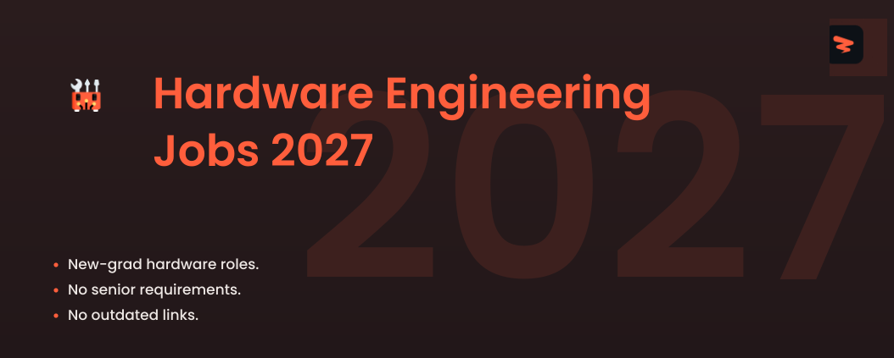

<!-- Cover -->

# Hardware Engineering Jobs 2027

🚀 Hardware, embedded systems, and EE jobs for new graduates, updated every 10 minutes.

  
  
  
  

---

## **Website & Autofill Extension**

Explore Zapply's website and check out:

- Our Chrome extension, which autofills job applications in seconds.
- A dedicated job board featuring the latest openings across various roles.
- User accounts with multiple profiles for different resume types and roles.
- Job application tracking with streaks and commitment awards.

Experience an advanced career journey with us! 🚀

  

## Explore Around

Connect and seek advice from a growing network of fellow students and new grads.

  
  &nbsp;&nbsp;
  

---

 

<h3>⚡ <strong>Hardware Engineer</strong></h3>

| Company | Role | Location | Posted | Visa | **Apply** |
|---------|------|----------|--------|------|----------|
| **Amentum** | Thermal Analysis Engineer | TX-Houston | 17m |  |  |
| **Northrop Grumman** | GNC Engineer: Actuators - Level 6 (Chandler) (AHT) | United States-Arizona-Chandler | 18m |  |  |
| **Novanta** | Planner \[C\] | Rocklin, CA | 26m |  |  |
| **NVIDIA** | SRAM Layout Design Engineer | CA Santa Clara | 39m | ✅ Sponsor |  |
| **GlobalFoundries** | Microsoft 365 Copilot & Collaboration Engineer | Austin | 49m | ✅ Sponsor |  |
| **GlobalFoundries** | AI enabled PDK Development Engineer | New York Malta | 49m | ✅ Sponsor |  |
| **GlobalFoundries** | Quantum Device Modeling Engineer | Texas Austin | 49m | ✅ Sponsor |  |
| **Intel** | Advanced Packaging Singulation Engineer | US, New Mexico, Albuquerque | 57m | ✅ Sponsor |  |
| **Blue Origin** | Structural Analyst III- Core Thermal/Fluids Lunar Permanence | Huntsville, AL | 2h |  |  |
| **GDIT** | Field Service Engineer - Must be within 1 hour drive of El Centro, CA | CA San Diego | 5h | ✅ Sponsor |  |
| **GDIT** | EPP III and all Military Generator (3 - 150KW) Electronics Technician Kuwait(secret clearance) | International | 5h | ✅ Sponsor |  |
| **ABB** | Mechanical Service Engineer - GMD/Hoisting | UT Salt Lake City | 5h | ✅ Sponsor |  |
| **ABB** | Hoisting Service Engineer | Arizona | 5h | ✅ Sponsor |  |
| **Anduril** | Avionics Systems Engineer, Space | Costa Mesa, California, United... | 7h |  |  |
| **Amentum** | Optical Design Engineer (SME2) | AL-Huntsville | 7h |  |  |
| **Amentum** | Aerospace Systems Engineer | AL-Huntsville | 7h |  |  |
| **RTX** | Mechanical Engineer I (Onsite) | AZ-TUCSON | 8h | ✅ Sponsor |  |
| **Northwood Space** | Electrical Engineer- Fleet Operations & Reliability | Torrance, CA | 10h |  |  |
| **Northwood Space** | Mechanical Engineer- Fleet Operations & Reliability | Torrance, CA | 10h |  |  |
| **Jabil** | MANUFACTURING AUTOMATION ENGINEER III | Grand Junction, CO | 10h | ✅ Sponsor |  |
| **Jabil** | Manufacturing Engineering Technician II (Weekend, 2nd Shift) | Byhalia, MS | 10h | ✅ Sponsor |  |
| **Jabil** | Manufacturing Engineering Technician II (1st Shift) | Byhalia, MS | 10h | ✅ Sponsor |  |
| **Anduril** | Loads and Dynamics Engineer, Missiles | Costa Mesa, California, United... | 10h |  |  |
| **Rocket Lab** | Spacecraft GNC Engineer II | Littleton, CO | 12h |  |  |
| **Relativity Space** | Loads and Dynamics Engineer II | Long Beach, California, United... | 12h | ✅ Sponsor |  |
| **Intuitive** | Manager System Analyst | Sunnyvale, CA | 12h | ✅ Sponsor |  |
| **SpaceX** | Production Development Technician (Starlink Aviation) | Woodinville, WA | 12h | ✅ Sponsor |  |
| **SpaceX** | Mechanical Design Engineer, Payloads (Falcon) | Hawthorne, CA | 12h | ✅ Sponsor |  |
| **Apple** | Hardware System Integration Electrical Engineer - Mac | Cupertino | 12h | ✅ Sponsor |  |
| **Anduril** | Technical Security Application Engineer, Special Projects | Costa Mesa, California, United... | 13h |  |  |
| **Amazon Data Services, Inc.** | DataCenter Structural Engineer, GSI | Seattle, WA | 13h | ✅ Sponsor |  |
| **Amazon Data Services, Inc.** | Hardware Development Engineer, AWS Mainstream Compute | Cupertino, CA | 13h | ✅ Sponsor |  |
| **Oracle** | Electrical Power Generation Engineer (Substation, MV & LV power) - Data Center Operations... | Nashville, TN, United States | 13h | ✅ Sponsor |  |
| **Apple** | Lab Operations Engineering Program Specialist | Cupertino | 13h | ✅ Sponsor |  |
| **University of Miami** | Imaging Equipment Engineer 2 - UHealth/SoLé Mia | North Miami, Florida | 13h |  |  |
| **First Solar** | Development Engineering Technician II | Perrysburg, OH, United States | 13h | ✅ Sponsor |  |
| **Illinois Tool Works** | Mechanical Engineer - Power Systems Division | Appleton, Wisconsin | 13h | ✅ Sponsor |  |
| **Illinois Tool Works** | Manufacturing Process Engineer | Machesney Park, Illinois | 13h | ✅ Sponsor |  |
| **BAE Systems** | Digital Hardware Engineer | Totowa, New Jersey | 13h |  |  |
| **The Trade Desk** | Systems Reliability Engineer | Boulder | 13h | ✅ Sponsor |  |
| **Toyota Research Institute** | Robotics Intern, Generalist Robot Learning (GRL) | Los Altos, CA | 13h | ✅ Sponsor |  |
| **Impulse Space** | Harnessing Design Engineer | Redondo Beach, California | Date unknown |  |  |
| **Schweitzer Engineering Laboratories** | Electrical Engineering Intern | California - Irvine | Date unknown | ✅ Sponsor |  |
| **Microsoft** | Thermal Engineer - XBOX | Mountain View, California,... | 13h | ✅ Sponsor |  |
| **Samsung Semiconductor** | Intern, HBM Memory Architecture | San Jose, California, United States | 14h | ✅ Sponsor |  |
| **Apple** | GPU Silicon Triage Engineer | Austin | 15h | ✅ Sponsor |  |
| **Archer** | Flight Test Instrumentation Engineer | San Jose, California, United States | 15h | ✅ Sponsor |  |
| **Bosch Group** | Product Development Engineer | Farmington Hills, MI | 15h | ✅ Sponsor |  |
| **Lightmatter** | Photonics Circuit Simulation Intern – Summer 2027 | Mountain View, CA | 16h | ✅ Sponsor |  |
| **Microsoft** | Mechanical Engineer | Boydton, Virginia, United States | 16h | ✅ Sponsor |  |
| **LG Electronics** | Development Engineer | Troy, MI | 16h |  |  |
| **Schweitzer Engineering Laboratories** | Power Systems Engineer- Protection | Georgia Alpharetta | Date unknown | ✅ Sponsor |  |
| **Schweitzer Engineering Laboratories** | Power Systems Engineer- Automation | Pennsylvania King of Prussia | Date unknown | ✅ Sponsor |  |
| **AMD** | SMTS Thermal Engineer | Santa Clara, CA, United States | 16h | ✅ Sponsor |  |
| **Scout Motors** | Mechanical Engineer | Blythewood, South Carolina,... | 16h | ✅ Sponsor |  |
| **Varda Space** | Automation & Controls Engineer II | El Segundo, California, United... | 16h |  |  |
| **Leidos** | Applied Physicist III | San Diego, CA | 17h | ✅ Sponsor |  |
| **Leidos** | Engineering Technician II | Waipahu, HI | 17h | ✅ Sponsor |  |
| **Eurofins** | Design & Construction Engineer | Lancaster, PA | 17h |  |  |
| **Zipline** | Material Planning Manager - PCBAs | South San Francisco,... | 18h | ✅ Sponsor |  |
| **Varda Space** | Astrodynamics Engineer II | El Segundo, California, United... | 18h |  |  |
| **Zoox** | Calibration, Localization and Mapping System Safety Engineer | Foster City, CA | 18h | ✅ Sponsor |  |
| **Western Digital** | Probe Process Engineer | Fremont, CA | 19h | ✅ Sponsor |  |
| **SpaceX** | Power Generation Engineer | Starbase, TX | 19h | ✅ Sponsor |  |
| **Neuralink** | Equipment Engineer | Fremont, California, United States | 19h | ✅ Sponsor |  |
| **Applied Materials** | Engineering Technician | Austin,TX | 19h | ✅ Sponsor |  |
| **Applied Materials** | Engineering Technician | Austin,TX | 19h | ✅ Sponsor |  |
| **Applied Materials** | Engineering Technician | Austin,TX | 19h | ✅ Sponsor |  |
| **LLNL** | Mechanical Engineer – Generalist | Livermore, CA | 19h | ✅ Sponsor |  |
| **Saronic Technologies** | Production Engineer | Brownsville, TX | 20h |  |  |
| **Veolia Environnement SA** | Instrumentation & Equipment Engineering Intern | Cary, NC | 20h | ✅ Sponsor |  |
| **Trane Technologies** | Engineering Co-Op | Tyler, Texas | 21h | ✅ Sponsor |  |
| **Eaton** | Mechanical Engineer - Sustaining | Arden, North Carolina, USA, 28704 | 21h |  |  |
| **AMD** | Power, Performance and Battery Life Customer Attainment Engineer | Austin, TX, United States | 21h | ✅ Sponsor |  |
| **Boston Scientific** | Field Service Engineer II - Boston, MA | Boston US-MA, United States   N/A | 21h |  |  |
| **Boston Scientific** | Field Service Engineer II - South Florida | Miami US-FL, United States ... | 21h |  |  |
| **IEM** | R&D Mechanical Engineer – Low Voltage | Franklin, Tennessee, United States | 22h |  |  |
| **AbbVie** | Engineering Technician (1st shift-Time:6:30am-2:30pm) | North Chicago, IL | 22h | ✅ Sponsor |  |
| **Barry-Wehmiller** | Mechanical Engineer II | Green Bay, WI | 1d |  |  |
| **AeroVironment** | Electronic Technician | Leesburg, VA | 1d |  |  |
| **AeroVironment** | Hardware Engineer - RF Systems | Sunrise, FL | 1d |  |  |
| **AeroVironment** | Manufacturing Engineering Technician III | Petaluma, CA | 1d |  |  |
| **Plexus** | Intern - Process Engineer (Fall 2027) | Neenah, WI | 1d |  |  |
| **Toyota Research Institute** | Robotics Intern, Prototyping and Robotics Operations | Cambridge, MA | 1d | ✅ Sponsor |  |
| **Philips** | Field Service Engineer, Multimodality Imaging (Travel: Honolulu/Hilo, HI) | Honolulu, Hawaii, United States | 1d | ✅ Sponsor |  |
| **Thermo Fisher Scientific** | Field Service Engineer II | Hillsboro, Oregon, USA | 1d | ✅ Sponsor |  |
| **Thermo Fisher Scientific** | Field Service Engineer III SEM/SDB/XPS (PNW REMOTE) | Washington | 1d | ✅ Sponsor |  |
| **Thermo Fisher Scientific** | Field Service Engineer | Remote, Texas, USA | 1d | ✅ Sponsor |  |
| **Sierra Nevada Corporation** | Electrical Engineer II | Lone Tree, CO | 1d |  |  |
| **Sierra Nevada Corporation** | Aerospace Engineer III - Certification Engineer | Lone Tree, CO | 1d |  |  |
| **Sierra Nevada Corporation** | Aerospace Engineer III - Certification Engineer | Dayton, OH | 1d |  |  |
| **ICF** | Grid Protection Engineer | Reston, VA | 1d |  |  |
| **Boeing** | Phantom Works Systems Integration Engineer (Experienced or Lead) | USA - Berkeley, MO | 1d |  |  |
| **Johnson Controls** | Security & Fire Inspection/Service Technician | Colorado... | 1d |  |  |
| **Johnson Controls** | Government Technologies Group - Junior Applications Engineer | Alexandria-Virginia-United... | 1d | ✅ Sponsor |  |
| **Johnson Controls** | Government Technologies Group - Applications Engineer | Montgomery-Alabama-United... | 1d | ✅ Sponsor |  |
| **KLA** | Semiconductor Field Service Engineer - New College Grads | Boise, ID | 1d | ✅ Sponsor |  |
| **KLA** | Mechanical Design Engineer | Totowa, NJ | 1d | ✅ Sponsor |  |
| **CAE** | Gulfstream Avionics Instructor | Savannah, GA | 1d | ✅ Sponsor |  |
| **AspenTech** | Early Careers Electrical Engineer - Power Systems | Houston | 1d | ✅ Sponsor |  |

Apply for more jobs at

<h3>🔲 <strong>FPGA/ASIC</strong></h3>

| Company | Role | Location | Posted | Visa | **Apply** |
|---------|------|----------|--------|------|----------|
| **Google** | TPU RTL Design Engineer | United States | Date unknown | ✅ Sponsor |  |
| **Amentum** | ASIC Verification Engineer | IN-Crane | 7h |  |  |
| **Jabil** | Associate Failure Analysis Engineer | San Jose, CA | 10h | ✅ Sponsor |  |
| **Samsung Semiconductor** | Intern, SSD Firmware Engineer | San Jose, California, United States | 14h | ✅ Sponsor |  |
| **AMD** | Technical Program Manager – Custom ASIC (Semi-Custom Engineering) | Austin, TX, United States | 15h | ✅ Sponsor |  |
| **Leidos** | Associate Mechanical Engineer | Huntsville, AL | 17h | ✅ Sponsor |  |
| **Leidos** | ​​FPGA Design Engineer​ | Huntsville, AL | 17h | ✅ Sponsor |  |
| **HPE** | ASIC Design for Test Engineer | Sunnyvale, California, United... | 1d | ✅ Sponsor |  |
| **Altera** | FPGA & Embedded SW Engineer – Aerospace & Defense | Hazlet | 1d | ✅ Sponsor |  |
| **Northrop Grumman** | 2027 Associate Liaison/MRB Engineer/ Liaison/MRB Engineer | United States-Utah-Clearfield | 1d |  |  |
| **Northrop Grumman** | 2026 Associate Thermal Mechanical Engineer  - Dulles | United States-Virginia-Dulles | 1d |  |  |
| **Northrop Grumman** | 2027 Associate Liaison/MRB Engineer/ Liaison/MRB Engineer | United States-Mississippi-Iuka | 1d |  |  |
| **Stryker** | Associate Field Service Representative | Baltimore Maryland | 1d | ✅ Sponsor |  |
| **Carrier Global** | Associate Controls Engineer - Building Automation Systems - Automated Logic | CAV20: ALC - Virginia, 4948... | 1d |  |  |
| **Marvell** | Firmware Engineer | Santa Clara, CA | 1d | ✅ Sponsor |  |
| **HPE (University)** | ASIC Design for Test Engineer | Sunnyvale, California, United... | 1d | ✅ Sponsor |  |
| **Broadcom** | ASIC Design Engineer | USA-Colorado-Fort Collins | 1d | ✅ Sponsor |  |
| **Broadcom** | ASIC DFT Engineer | USA-CA San Jose Innovation Drive | 1d | ✅ Sponsor |  |
| **Broadcom** | ASIC DFT Engineer | USA-CA San Jose Innovation Drive | 1d | ✅ Sponsor |  |
| **Boeing** | Associate or Experienced Fatigue & Fracture Analysis Engineer | Berkeley, MO | 1d | ✅ Sponsor |  |
| **Analog Devices** | Associate Processing Sustaining Engineer | US, OR, Beaverton | 1d | ✅ Sponsor |  |
| **Analog Devices** | Digital Design Engineering Intern - Summer 2027 | US, TX, Austin, Plaza on the Lake | 1d | ✅ Sponsor |  |
| **Cisco** | ASIC DFT Engineer | Austin, Texas, US | 1d | ✅ Sponsor |  |
| **NVIDIA** | ASIC Verification Engineer | US, TX, Austin | 1d | ✅ Sponsor |  |
| **NVIDIA** | ASIC Design Engineer - Hardware | US, TX, Austin | 1d | ✅ Sponsor |  |
| **RTX** | FPGA/ Digital Design Engineer I - Onsite | MA-TEWKSBURY-TB4 | 1d | ✅ Sponsor |  |
| **Blue Origin** | FPGA Designer - TeraWave RF and Optical Systems Firmware | Greater Seattle Area | 1d |  |  |
| **Eversource Energy** | Associate Engineer, Substation Engineering (Hybrid Schedule) | Manchester, NH | 1d | ✅ Sponsor |  |
| **GE Vernova** | Engineer 1 - Firmware Engineer | Salem VA USA | 1d | ✅ Sponsor |  |
| **Odin Dynamics** | Power Systems Firmware Engineer | Long Beach | 1d |  |  |
| **Apple** | SoC RTL Design Engineer | Austin | 1d | ✅ Sponsor |  |
| **Cisco** | ASIC DFT Engineer | Austin, Texas | 1d | ✅ Sponsor |  |
| **BAE Systems** | FPGA Design Engineer II | Nashua, New Hampshire | 1d |  |  |
| **Apple** | SoC PD Methodology Silicon Correlation Engineer | Austin | 1d | ✅ Sponsor |  |
| **Apple** | Media-IP SoC Performance Engineer, Platform Architecture | Cupertino | 1d | ✅ Sponsor |  |
| **Eurofins** | Associate Engineer, Electrical Failure Analysis | Sunnyvale, CA | 1d |  |  |
| **Graco** | Associate Mechanical Engineer | Erie, Pennsylvania, USA | 2d | ✅ Sponsor |  |
| **RTX** | FPGA Design Engineer II | AZ-TUCSON-M02 | 2d | ✅ Sponsor |  |
| **Microchip Technology** | Intern - Engineering (ASIC Verification) | CA - San Jose | 2d | ✅ Sponsor |  |
| **Booz Allen Hamilton** | Embedded FPGA Engineer | McLean, VA | 2d | ✅ Sponsor |  |
| **Intel** | SoC Physical Design & Full-Chip Integration Engineer | Oregon Hillsboro | 2d | ✅ Sponsor |  |
| **Boeing** | ASIC Subsystem Engineer (Mid-level or Lead) | USA - El Segundo, CA | 2d | ✅ Sponsor |  |
| **Boeing** | Associate Electromagnetic Compatibility Engineer | USA - Berkeley, MO | 2d | ✅ Sponsor |  |
| **Cisco** | ASIC DFT DV Engineer | Austin, Texas, US | 2d | ✅ Sponsor |  |
| **Google** | ASIC Design Verification Engineer, TPU, Chip Implementation and Infrastructure | United States | Date unknown | ✅ Sponsor |  |
| **NVIDIA** | ASIC Design Engineer – Clocks IP | CA Santa Clara | 2d | ✅ Sponsor |  |
| **RTX** | FPGA/ASIC Engineer 1 (Onsite) | IA-CEDAR RAPIDS | 2d | ✅ Sponsor |  |
| **LLNL** | Photonics/Laser Electro-Optics Engineering Technical Associate | Livermore, CA | 2d | ✅ Sponsor |  |
| **Wavetronix** | Embedded Firmware Engineer | Springville, Utah | 2d |  |  |
| **Impulse Space** | Digital Design (FPGA/ASIC) Engineering Internship (Summer 2027) | Redondo Beach, California | Date unknown |  |  |
| **Aerospace Corporation** | 2027 Associate RF / Antenna Engineer | Chantilly, VA | 3d |  |  |
| **Carrier Global** | Associate Mechanical Engineer | CAI23: Carrier-Indianapolis,... | 3d |  |  |
| **Entegris** | Scientist I, Research Associate | Aurora, IL | 3d | ✅ Sponsor |  |
| **Aerospace Corporation** | FPGA Firmware Design Engineer | El Segundo, CA | 3d |  |  |
| **Aerospace Corporation** | FPGA Firmware Design Engineer | El Segundo, CA | 3d |  |  |
| **GE Healthcare** | Firmware Engineer | Waukesha | 3d | ✅ Sponsor |  |
| **Cummins** | Instrumentation Engineering Associate - OCU - Technical - 1st Shift | Columbus, IN, United States | 3d | ✅ Sponsor |  |
| **Cummins** | Mechanical Engineering Associate - OCU - Technical - 1st Shift | Seymour, IN, United States | 3d | ✅ Sponsor |  |
| **First Solar** | Engineer- Associate Manufacturing Technology Scaling USA | OH, United States | 3d | ✅ Sponsor |  |
| **First Solar** | Engineer- Associate Manufacturing Technology Scaling USA | OH, United States | 3d | ✅ Sponsor |  |
| **BAE Systems** | Engineer II - FPGA Verification | Westminster, Colorado | 5d |  |  |
| **Xcimer Energy** | Associate Laser Scientist - Experimental | Denver, CO | 5d |  |  |
| **AMD** | ASIC/SoC Design Engineer | San Jose, CA, United States | 5d | ✅ Sponsor |  |
| **Carnegie Mellon University** | Postdoctoral Research Associate - College of Engineering - Department of Mechanical Engineering | Pittsburgh, PA | 6d | ✅ Sponsor |  |
| **Carrier Global** | Associate Field Engineer - Automated Logic | CAW11: ALC-Brown Deer, 1501... | 6d |  |  |
| **Fluor** | Associate HVAC Design Engineer II | Greenville, US-SC, United States | 6d |  |  |
| **KLA** | Associate Test Engineer 2 | Milpitas, CA | 6d | ✅ Sponsor |  |
| **National Interstate Insurance** | Associate Product Analyst - Embedded Solutions | Cincinnati, OH | 6d |  |  |
| **Google** | RTL Design Engineer, Google | United States | Date unknown | ✅ Sponsor |  |
| **ABB** | R&D Associate Engineer - Power Electronics | Richmond, Virginia, United... | 6d | ✅ Sponsor |  |
| **BlackRock** | Associate, Application Engineer | San Francisco, CA | 6d | ✅ Sponsor |  |
| **Moog** | Associate Design Engineer | Buffalo, NY | 6d |  |  |
| **Caterpillar** | Associate Design Engineer | Alpharetta, Georgia | 6d | ✅ Sponsor |  |
| **Fluor** | Associate HVAC Design Engineer III | Houston, US-TX, United States | 6d |  |  |
| **Qualcomm** | Next-Gen, High-Speed Memory Subsystem ASIC Digital Design Engineer | San Diego, CA | 6d | ✅ Sponsor |  |
| **Qualcomm** | CPU Synthesis CAD Engineer | Santa Clara, CA | 6d | ✅ Sponsor |  |
| **Qualcomm** | GSoC Design Verification Engineer | San Diego, CA | 6d | ✅ Sponsor |  |
| **MITRE** | Associate Embedded Security Engineer | Bedford, Massachusetts | 6d |  |  |
| **AMD** | Fellow Firmware Engineering | Santa Clara, CA, United States | 6d | ✅ Sponsor |  |
| **Fluor** | Associate Design Engineer III  (Structural) | Houston, US-TX, United States | 6d |  |  |
| **Carnegie Mellon University** | Postdoctoral Research Associate - College of Engineering - Department of Mechanical Engineering | Pittsburgh, PA | 1w | ✅ Sponsor |  |
| **Booz Allen Hamilton** | Cybersecurity Firmware Engineer, Mid | Rome, NY | 1w | ✅ Sponsor |  |
| **Analog Devices** | Associate Equipment Engineer | MA Wilmington | 1w | ✅ Sponsor |  |
| **Micron Technology** | SoC Physical Design Formal Verification Engineer, HBM | Folsom, CA | 1w | ✅ Sponsor |  |
| **Micron Technology** | HBM SoC Physical Design Engineer | Folsom, CA | 1w | ✅ Sponsor |  |
| **OpenAI** | Firmware Engineer, Robotics | San Francisco | 1w | ✅ Sponsor |  |
| **Moog** | Associate Test Engineer | Santa Barbara, CA | 1w |  |  |
| **Caterpillar** | Associate HMI Design Engineer | Alpharetta, Georgia | 1w | ✅ Sponsor |  |
| **Micron** | HBM SoC Physical Design Engineer | Folsom, California, United... | 1w |  |  |
| **Micron** | SoC Physical Design Formal Verification Engineer, HBM | Folsom, California, United... | 1w |  |  |
| **Zoox** | Contract Student Worker  – Firmware Engineer (FW Core System Services) | Foster City, CA | 1w | ✅ Sponsor |  |
| **Target** | Associate Buyer - Men's Owned Brand Basics, Lounge and Accessories | Minneapolis, MN | 1w | ✅ Sponsor |  |
| **Annapurna Labs (U.S.) Inc.** | Physical Design Engineer - Static Timing Analysis, Annapurna Labs, Cloud Scale Machine Learning | Cupertino, CA | 1w | ✅ Sponsor |  |
| **Vertiv** | Firmware Engineer II | Delaware, OH, United States | 1w | ✅ Sponsor |  |
| **LLNL** | Engineering Technical Associate – Kinetic Technologies | Livermore, CA | 1w | ✅ Sponsor |  |
| **NBCUniversal** | Associate Design Engineer | New York, NEW YORK | 1w | ✅ Sponsor |  |
| **Veolia Environnement SA** | Associate Electrical, Instrumentation & Controls Engineer - Water Technologies | Glen Allen, VA | 1w | ✅ Sponsor |  |
| **Veolia Environnement SA** | Associate Electrical, Instrumentation & Controls Engineer - Water Technologies | Bellevue, WA | 1w | ✅ Sponsor |  |
| **Veolia Environnement SA** | Associate Electrical, Instrumentation & Controls Engineer - Water Technologies | Minnetonka, MN | 1w | ✅ Sponsor |  |
| **GE Aerospace** | Entry Level - FPGA Design/Verification Engineer | Grand Rapids | 1w | ✅ Sponsor |  |

Apply for more jobs at

<h3>🔌 <strong>Embedded Systems</strong></h3>

| Company | Role | Location | Posted | Visa | **Apply** |
|---------|------|----------|--------|------|----------|
| **GE Aerospace** | Embedded Product Cybersecurity Engineer – Embedded Software | Evendale | 1d | ✅ Sponsor |  |
| **NVIDIA** | Senior Solutions Architect – Robotics Embedded Systems and Safety | CA Santa Clara | 1d | ✅ Sponsor |  |
| **Odin Dynamics** | Embedded Linux Engineer | Long Beach | 1d |  |  |
| **Microsoft** | Research Intern - Firmware Security | Redmond, Washington, United States | 1d | ✅ Sponsor |  |
| **Solidigm** | Firmware Validation Engineer | Sacramento, CA | 1d |  |  |
| **KLA** | Firmware Intern | Milpitas, CA | 3d | ✅ Sponsor |  |
| **Motorola Solutions** | Embedded Software Engineer - R&D | Los Angeles, CA | 3d | ✅ Sponsor |  |
| **Analog Devices** | Embedded Hardware & Firmware Intern (Health Solutions) | US, MA, Wilmington | 3d | ✅ Sponsor |  |
| **NVIDIA** | Firmware System Integration Engineer | US, CA, Santa Clara | 3d | ✅ Sponsor |  |
| **RTX** | Embedded Cybersecurity Researcher - Onsite | IA-CEDAR RAPIDS | 3d | ✅ Sponsor |  |
| **Aerospace Corporation** | Small Satellite Embedded Software Engineer | El Segundo, CA | 3d |  |  |
| **Aerospace Corporation** | Embedded Software Engineer (mid level) | El Segundo, CA | 3d |  |  |
| **Aerospace Corporation** | Embedded Software Test Engineer | El Segundo, CA | 3d |  |  |
| **MITRE** | Intermediate Embedded Security Engineer | Bedford, Massachusetts | 5d |  |  |
| **Samsung Semiconductor** | Intern, SSD Firmware Development | San Jose, California, United States | 5d | ✅ Sponsor |  |
| **RTX** | Applied Research Engineer – Embedded Battlespace Systems (Onsite) | IA-CEDAR RAPIDS | 6d | ✅ Sponsor |  |
| **Blue Origin** | MK1 Embedded Controller Test Engineer III | Greater Seattle Area | 6d |  |  |
| **Entegris** | Embedded Software Engineering Intern | Bloomington, MN | 6d | ✅ Sponsor |  |
| **ASML** | Embedded Software Engineer | Wilton, CT, USA | 1w | ✅ Sponsor |  |
| **Trane Technologies** | Embedded SW Engineer | La Crosse, Wisconsin | 1w | ✅ Sponsor |  |
| **Teledyne** | Embedded Software Engineer | Goleta, CA | 1w |  |  |
| **Northrop Grumman** | Embedded Software Engineer-Level 2 (AHT) | United States-California-Northridge | 1w |  |  |
| **RTX** | Electrical (Firmware) Engineering Intern (Summer 2027)(Onsite) | IN-FT WAYNE | 1w | ✅ Sponsor |  |
| **Sopra Steria** | Embedded System-on-Chip Development Engineer | East Hartford, CT | 1w |  |  |
| **Lightmatter** | Laser Firmware Intern - Summer 2027 | Boston, MA | 1w | ✅ Sponsor |  |
| **Arrow Electronics** | Embedded Engineer (eInfochip Inc) | CA-California | 1w | ✅ Sponsor |  |
| **Motorola Solutions** | 2027 Summer Embedded SW Engineering Intern | Schaumburg, IL | 1w | ✅ Sponsor |  |
| **Stanley Black & Decker** | Project Engineer, Firmware | Towson, MD, United States | 1w | ✅ Sponsor |  |
| **Motorola Solutions** | Embedded Software Engineer | Irvine, CA | 1w | ✅ Sponsor |  |
| **Teledyne** | Software Engineer - Embedded Applications (US Citizenship Required) | Oak Ridge, TN | 1w |  |  |
| **Northrop Grumman** | Embedded Software Engineer-Level 3/4 (AHT) | United States-California-Northridge | 1w |  |  |
| **Northrop Grumman** | Embedded Software Engineer – Level 2 | United States-Virginia-Dulles | 1w |  |  |
| **Eaton** | Embedded Hardware Electronics Engineering Specialist | Moon Township, Pennsylvania,... | 1w |  |  |
| **Intuitive** | Embedded Product Security Analyst | Sunnyvale, CA | 1w | ✅ Sponsor |  |
| **Analog Devices** | Embedded AI Tools Engineer | US, MA, Wilmington | 1w | ✅ Sponsor |  |
| **JPMorgan Chase** | Embedded Payments Product Solutions Architect-Executive Director | Chicago, IL, United States | 1w | ✅ Sponsor |  |
| **Apple** | Firmware Validation Engineer | San Francisco Bay Area | 1w | ✅ Sponsor |  |
| **Apple** | Firmware Validation Engineer | San Francisco Bay Area | 1w | ✅ Sponsor |  |
| **Parsons** | Summer Embedded Developer Intern | MD, Columbia, R188299 | Date unknown |  |  |
| **Lightmatter** | Embedded Software Engineer | Boston, MA | 2w | ✅ Sponsor |  |
| **Philips** | Co-op -Embedded Test Engineer - Murrysville, PA-January-June 2027 | Murrysville, Pennsylvania,... | 3w | ✅ Sponsor |  |
| **Xcimer Energy** | Embedded Engineer | Denver, CO | 3w |  |  |
| **Analog Devices** | Embedded Systems Co-Op | US, MA, Boston | 3w | ✅ Sponsor |  |
| **Verkada** | Firmware Release & Test Automation Engineer | San Mateo, CA United States | 3w | ✅ Sponsor |  |
| **Micron Technology** | Intern - SSD Firmware | San Jose, CA | 4w | ✅ Sponsor |  |
| **Micron Technology** | Intern - SSD Firmware | Boise ID Main Site | 4w | ✅ Sponsor |  |
| **Micron Technology** | Intern - SSD Firmware - CICD | Longmont-MAX- | 1mo | ✅ Sponsor |  |
| **Stanley Black & Decker** | Embedded Engineering Summer Intern 2027 | Towson, MD, United States | 1mo | ✅ Sponsor |  |
| **iRhythm** | Embedded SDET Co-Op Full Time Intern January-June 2027 | San Francisco, CA | 1mo |  |  |
| **Penn State University** | Embedded Systems and Hardware Co-Op | Warminster, PA | 1mo |  |  |
| **Micron** | Intern - SSD Firmware - CICD | Longmont, Colorado, United... | 1mo |  |  |
| **Agility Robotics** | Firmware Manager | Hybrid- Fremont, CA | 1mo | ✅ Sponsor |  |
| **Amazon.com Services LLC - A57** | Embedded Firmware Co-op, Amazon Robotics - Spring 2027 | North Reading, MA | 1mo | ✅ Sponsor |  |
| **Qualcomm** | Embedded Engineering Internship - Summer 2027 | San Diego, CA | 1mo | ✅ Sponsor |  |
| **WHOOP** | Embedded Engineer II | Boston, MA | 2026-09-14 | ✅ Sponsor |  |
| **Physical Intelligence** | Embedded Engineer | San Francisco | 2026-09-12 |  |  |
| **Verkada** | Embedded UI Engineer | San Mateo, CA United States | 2026-09-09 | ✅ Sponsor |  |
| **Flagship Pioneering** | Pioneering Intelligence: Data Science Co-Op (Embedded Science Team) | Cambridge, MA USA | 2026-09-08 |  |  |
| **SpaceX** | GNC Engineer - Embedded Controls (Starlink) | Redmond, WA | 2026-09-04 | ✅ Sponsor |  |
| **Verkada** | Embedded Engineer - Streaming | San Mateo, CA United States | 2026-09-03 | ✅ Sponsor |  |
| **Zoox** | Wireless Firmware Validation Engineer | Foster City, CA | 2026-08-26 | ✅ Sponsor |  |
| **Honeywell** | Embedded Engineer - Summer 2027 Intern (US Person Required) | United States | 2026-08-25 | ✅ Sponsor |  |
| **Honeywell** | Embedded Engineer - Summer 2027 Intern | United States | 2026-08-25 | ✅ Sponsor |  |
| **Waabi** | V&V Engineer, Firmware | Pittsburgh, PA | 2026-08-18 | ✅ Sponsor |  |
| **SpaceX** | Embedded Security Engineer (Starlink) | Bastrop, TX | 2026-08-18 | ✅ Sponsor |  |
| **SpaceX** | Embedded Security Engineer (Starlink) | Hawthorne, CA | 2026-08-18 | ✅ Sponsor |  |
| **Applied Intuition** | Embedded Test Engineer - New Grad (2027) | Sunnyvale | 2026-08-14 | ✅ Sponsor |  |
| **Applied Intuition** | Embedded Firmware Validation Engineer | Sunnyvale | 2026-08-14 | ✅ Sponsor |  |
| **Qrypt** | Embedded Software Engineer | Germantown, MD | 2026-07-09 |  |  |
| **Deepgram** | Embedded AI Engineer, On-Device Models | USA - Remote | 2026-07-07 |  |  |
| **AMD** | Hardware Systems Design Engineer – x86 Embedded Solutions | San Jose, CA, United States | 2026-05-28 | ✅ Sponsor |  |
| **Etched** | Firmware Intern | San Jose | 2026-02-07 | ✅ Sponsor |  |
| **Anduril** | Embedded NixOS Engineer | Costa Mesa, California, United... | 2026-02-05 |  |  |
| **Neuralink** | Embedded Software Engineer, Implant Embedded Systems | Austin, Texas, United States | 2025-04-21 | ✅ Sponsor |  |
| **Applied Intuition** | Embedded Security Engineer | Sunnyvale | 2024-06-19 | ✅ Sponsor |  |

Apply for more jobs at

<h3>🔋 <strong>Electrical Engineer</strong></h3>

| Company | Role | Location | Posted | Visa | **Apply** |
|---------|------|----------|--------|------|----------|
| **GlobalFoundries** | Design-for-Test Engineer (2027 New College Graduate) | USA - Texas - Richardson | 49m | ✅ Sponsor |  |
| **Blue Origin** | Test Engineer III - HBR MC | Longmont, CO | 2h |  |  |
| **Jabil** | Test Engineer II | Memphis, TN | 10h | ✅ Sponsor |  |
| **Varda Space** | Spacecraft Systems Integration & Test Engineer | El Segundo, California, United... | 11h |  |  |
| **BAE Systems** | System Test Engineer - RF Systems | Westminster, Colorado | 13h |  |  |
| **Apple** | Touch HW EE Validation Engineer | Austin | 14h | ✅ Sponsor |  |
| **Apple** | GPU Silicon Validation Engineer | Austin | 16h | ✅ Sponsor |  |
| **Apple** | GPU Silicon Validation Engineer | Austin | 16h | ✅ Sponsor |  |
| **SpaceX** | Integration & Test Engineer (Starlink Propulsion) | Redmond, WA | 18h | ✅ Sponsor |  |
| **General Matter** | Pulsed Power Engineer | Los Angeles, CA | 18h |  |  |
| **Rocket Lab** | Test Engineer II – Stage Fluids and Propulsion Components | Long Beach, CA | 18h |  |  |
| **Bosch Group** | Acquisition & Project Manager- Power Electronics | Farmington Hills, MI | 19h | ✅ Sponsor |  |
| **Eaton** | Chief Power Electronics Engineer | Raleigh, North Carolina, USA, 27616 | 21h |  |  |
| **Illumina** | Validation Engineer 2 | California - San Diego | 1d | ✅ Sponsor |  |
| **CACI** | Data Test Engineer | Any State | 1d | ✅ Sponsor |  |
| **Sierra Nevada Corporation** | Test Engineer II | Sparks, NV | 1d |  |  |
| **Sierra Nevada Corporation** | Test Engineer Intern (Summer 2027) | Sparks, NV | 1d |  |  |
| **Northrop Grumman** | 2027 Propulsion Test Engineer Intern - Edwards AFB CA | United... | 1d |  |  |
| **Palo Alto Networks** | Early in Career - AI Test Engineer |  | 1d | ✅ Sponsor |  |
| **Allegion** | Manufacturing Test Engineer | Princeton, IL | 1d |  |  |
| **Pfizer** | Validation Engineer III | United States - Connecticut -... | 1d | ✅ Sponsor |  |
| **KLA** | Electrical Design Engineer | Milpitas, CA | 1d | ✅ Sponsor |  |
| **Analog Devices** | Analog Design Engineering Intern | US, OR, Beaverton | 1d | ✅ Sponsor |  |
| **Analog Devices** | Analog Design Engineer | MA Wilmington | 1d | ✅ Sponsor |  |
| **Analog Devices** | Analog Design Engineer Intern | US, CA, San Jose, Rio Robles | 1d | ✅ Sponsor |  |
| **RTX** | Optical Test Engineer 2 | TX-MCKINNEY | 1d | ✅ Sponsor |  |
| **Blue Origin** | MK1 Avionics Test Engineer III | Greater Seattle Area | 1d |  |  |
| **Blue Origin** | Environmental Test Engineer, Project Sunrise - Orbital Data Centers | Denver, CO | 1d |  |  |
| **Caterpillar** | Electrical Design Engineer – Switchgear & Controls | Alpharetta, Georgia | 1d | ✅ Sponsor |  |
| **Google** | Silicon Validation Engineer, Google Cloud | United States | Date unknown | ✅ Sponsor |  |
| **Odin Dynamics** | Powertrain Integration and Test Engineer | Long Beach | 1d |  |  |
| **Odin Dynamics** | Power Electronics Engineer | Long Beach | 1d |  |  |
| **CACI** | Section 508 Compliance Test Engineer | Any State | 1d | ✅ Sponsor |  |
| **Radiant Industries** | Integration & Test Engineer II | El Segundo, CA | 1d |  |  |
| **Jabil** | Test Engineer III - AI/ML Server Platforms (401 Shift) | Florence, KY | 1d | ✅ Sponsor |  |
| **Microsoft** | Memory Circuit Design Engineer | Raleigh, North Carolina, United... | 1d | ✅ Sponsor |  |
| **Cummins** | Experimental Mechanics - Test Engineer | Seymour, IN, United States | 1d | ✅ Sponsor |  |
| **Texas Instruments** | Design Verification Engineer (Analog Mixed Signal) | Longmont, CO, United States | 1d | ✅ Sponsor |  |
| **General Atomics** | Flight Test Engineer | Poway, California | 1d |  |  |
| **General Atomics** | Intern - Spacecraft Test Engineering | Centennial, Colorado | 1d |  |  |
| **General Atomics** | Aerospace Vibration Assembly, Integration &amp; Test Engineer | Acton, Massachusetts | 1d |  |  |
| **Emerson Electric** | Electrical Design Engineer - Installations | Pittsburgh, PA, United States | 1d | ✅ Sponsor |  |
| **BAE Systems** | Test Engineer - Prin | Nashua, New Hampshire | 1d |  |  |
| **SpaceX** | Battery Test Engineer, Satellites (Starlink) | Redmond, WA | 1d | ✅ Sponsor |  |
| **Leidos** | Electrical Design Engineering Intern | Huntsville, AL | 1d | ✅ Sponsor |  |
| **SpaceX** | Avionics Integration & Test Engineer (Starshield) | Hawthorne, CA | 1d | ✅ Sponsor |  |
| **Lightmatter** | Product & Test Engineering, Intern Summer 2027 | Mountain View, CA | 1d | ✅ Sponsor |  |
| **Saronic Technologies** | R&D Test Engineer | Austin, TX | 1d |  |  |
| **Northrop Grumman** | Aeronautical Integration and Test Engineer Level 1 or Level 2 | United States-Alabama-Huntsville | 2d |  |  |
| **GlobalFoundries** | Cryo CMOS Analog Design Engineer | Austin | 2d | ✅ Sponsor |  |
| **GlobalFoundries** | Quantum Analog IC Design Engineer | Austin | 2d | ✅ Sponsor |  |
| **Booz Allen Hamilton** | Systems Test Engineer | Lexington Park, MD | 2d | ✅ Sponsor |  |
| **Ultra Intelligence & Communications** | Test Engineer 1 | Austin TX United States | 2d |  |  |
| **KLA** | Mixed-Signal Electrical Design Engineer | Milpitas, CA | 2d | ✅ Sponsor |  |
| **Philips** | R&D Test Engineer, Ultrasound (Cambridge, MA) | Cambridge (US), Massachusetts,... | 2d | ✅ Sponsor |  |
| **Boeing** | Experienced Electro Optics / Infrared Lab Test Engineer | USA - Berkeley, MO | 2d | ✅ Sponsor |  |
| **Brunswick** | Vibration Test Engineer | Fond du Lac, WI | 2d | ✅ Sponsor |  |
| **Cadence** | Product Engineer (Analog Circuit Design) | SAN JOSE | 2d |  |  |
| **CACI** | CASPORT Test Engineer (ICAM Systems) | Hanover, MD, US | 2d | ✅ Sponsor |  |
| **Moog** | Electrical Design Engineer | Buffalo, NY | 2d |  |  |
| **ASML** | System Integration and Test Engineer Back End Nights ( 6:00 PM – 6:00 AM (Wednesday, Thursday,... | Wilton, CT, USA | 2d | ✅ Sponsor |  |
| **Jabil** | Test Engineering Technician I | St. Petersburg/Tampa, FL | 2d | ✅ Sponsor |  |
| **Texas Instruments** | Analog IC Design Engineer   BCP | Santa Clara, CA, United States | 2d | ✅ Sponsor |  |
| **Texas Instruments** | Analog IC Design (AI/ML) Engineering Intern | Dallas, TX, United States | 2d | ✅ Sponsor |  |
| **Anduril** | Development Test Engineer - Air Dominance & Strike | Costa Mesa, California, United... | 2d |  |  |
| **Etched** | Manufacturing Test Engineer | San Jose | 2d | ✅ Sponsor |  |
| **Leidos** | Integration and Test Engineer Intern | Atlantic City, NJ | 2d | ✅ Sponsor |  |
| **Mach Industries** | Test Engineer | Huntington Beach, California,... | 2d |  |  |
| **Anduril** | Electrical Test Engineer | Atlanta, Georgia, United States | 2d |  |  |
| **Google** | Electrical Design Engineer, Platforms | United States | Date unknown | ✅ Sponsor |  |
| **AeroVironment** | RF PCBA Design and Test Engineer | Albuquerque, NM | 3d |  |  |
| **Curtiss-Wright** | Test Engineer | NC-Shelby | 3d |  |  |
| **Aerospace Corporation** | 2027 Systems Integration and Test Engineer Graduate Intern | Chantilly, VA | 3d |  |  |
| **Crane Co.** | Test Engineer | Elyria, Ohio | 3d | ✅ Sponsor |  |
| **Intel** | Mixed Signal Design Verification Engineer | Oregon Hillsboro | 3d | ✅ Sponsor |  |
| **RTX** | Environmental Test Engineer Support | TX-MCKINNEY | 3d | ✅ Sponsor |  |
| **NVIDIA** | ATE Test Engineer | US, CA, Santa Clara | 3d | ✅ Sponsor |  |
| **Aerospace Corporation** | Microwave Test Engineer | El Segundo, CA | 3d |  |  |
| **GE Vernova** | GE Vernova Gas Power Engineering - Fall 2027 Intern | Greenville | 3d | ✅ Sponsor |  |
| **Micron Technology** | Engineer-Design Methodology-Analog Testbench Development | Boise, ID - Main Site | 3d | ✅ Sponsor |  |
| **Northrop Grumman** | Electrical Integration & Test Engineer (Level 3 or 4) | United States-Arizona-Chandler | 3d |  |  |
| **Micron** | Engineer-Design Methodology-Analog Testbench Development | Boise, Idaho, United States of... | 3d |  |  |
| **Vertiv** | Test Engineer | Delaware, OH, United States | 3d | ✅ Sponsor |  |
| **Illinois Tool Works** | Power Electronics Engineer | Eden Prairie, Minnesota | 3d | ✅ Sponsor |  |
| **BAE Systems** | Flight Test Engineering Analyst/Manager | Hill AFB, Utah | 4d |  |  |
| **Leidos** | RADAR Integration and Test Engineer | Huntsville, AL | 5d | ✅ Sponsor |  |
| **Lucid Motors** | Manager, Power Electronics Test & Validation | Newark, CA | 5d | ✅ Sponsor |  |
| **Lightmatter** | Hardware Test Engineering, Intern (Summer 2027) | Mountain View, CA | 5d | ✅ Sponsor |  |
| **Eaton** | Electrical Design Engineer | Cleveland, Tennessee, USA, 37312 | 5d |  |  |
| **AST SpaceMobile** | Solar Panel Test Engineer | Midland, Texas, United States | 5d | ✅ Sponsor |  |
| **Anduril** | Laser Test Engineer | Lexington, Massachusetts,... | 5d |  |  |
| **Varda Space** | Spacecraft Avionics Test Engineer II | El Segundo, California, United... | 5d |  |  |
| **Booz Allen Hamilton** | Test Engineer | Aurora, CO | 6d | ✅ Sponsor |  |
| **NVIDIA** | Hardware Design Validation Engineer | US, CA, Santa Clara | 6d | ✅ Sponsor |  |
| **Google** | Hardware Systems Test Engineer, Networking, Platforms Infrastructure Engineering | United States | Date unknown | ✅ Sponsor |  |
| **NREL** | Postdoctoral Researcher - Power Electronics | Golden, CO | 6d | ✅ Sponsor |  |
| **GDIT** | Automated Test Engineer (Hybrid Telework) - TS/SCI /w poly required | USA MD Annapolis Junction | 6d | ✅ Sponsor |  |
| **Zone 5 Technologies** | Developmental Test Engineer | San Luis Obispo, California | 6d |  |  |
| **Amazon Development Center U.S., Inc.** | Hardware Validation Engineer, NPD Hardware | Cupertino, CA | 6d | ✅ Sponsor |  |
| **Vertiv** | Electrical Design Engineer | Pelzer, SC, United States | 6d | ✅ Sponsor |  |

Apply for more jobs at

<h3>✅ <strong>Validation Engineer</strong></h3>

| Company | Role | Location | Posted | Visa | **Apply** |
|---------|------|----------|--------|------|----------|
| **AeroVironment** | Supplier Quality Engineer | Albuquerque, NM | 6m |  |  |
| **RTX** | Sustainment Quality Engineer (Onsite) | FL-JUPITER-ADR | 6m | ✅ Sponsor |  |
| **Jabil** | NPI Test Development Engineer Manager | Austin, TX | 10h | ✅ Sponsor |  |
| **Solidigm** | NAND Product Development Engineer (Validation) | Rancho Cordova, CA | 12h |  |  |
| **Apple** | AIML - LLM Inference Quality Engineer | Seattle | 13h | ✅ Sponsor |  |
| **Boston Scientific** | Design Quality Engineer III - Interventional Oncology & Embolization (IO&E) | Maple Grove US-MN, United... | 13h |  |  |
| **Anduril** | Product Quality Engineer - Barracuda | Santa Ana, California, United... | 14h |  |  |
| **Apple** | Image Quality Engineer - Camera and Photos | Cupertino | 15h | ✅ Sponsor |  |
| **Boston Scientific** | Quality Engineer II - Post-Market Trending - Defined Term 18 months | Arden Hills US-MN, United... | 17h |  |  |
| **ABB** | Process Quality Engineer | USA, MS, Senatobia | 19h | ✅ Sponsor |  |
| **John Deere** | Quality Engineer | Waterloo,Iowa,United States | 22h |  |  |
| **Medtronic** | Quality Engineer I  (CAS), Rice Creek, MN | Minneapolis, Minnesota, United... | 1d | ✅ Sponsor |  |
| **Medtronic** | Quality Engineer II | Lafayette, Colorado, United... | 1d | ✅ Sponsor |  |
| **Danaher** | Quality Engineer - Aerospace | New Port Richey, Florida,... | 1d | ✅ Sponsor |  |
| **ASML** | Supplier Quality Engineering Group Team Lead | San Diego, CA, USA | 1d | ✅ Sponsor |  |
| **Teledyne** | Quality Engineer | North Falmouth, MA | 1d |  |  |
| **Campbell Soup Company** | Quality Engineer | USA - PA - Denver | 1d |  |  |
| **Boeing** | Experienced Quality Engineer | Hialeah, FL | 1d | ✅ Sponsor |  |
| **RTX** | Quality Engineer II (On site) | IA-CEDAR RAPIDS | 1d | ✅ Sponsor |  |
| **Blue Origin** | Quality Engineer III - Lunar | Space Coast, FL | 1d |  |  |
| **Caterpillar** | Supply Quality Engineer II | Brooklyn Park, Minnesota | 1d | ✅ Sponsor |  |
| **Moog** | Quality Engineer | Buffalo, NY | 1d |  |  |
| **Moog** | Intern, Quality Engineering | Torrance, CA | 1d |  |  |
| **Anduril** | Supplier Quality Engineer, Maritime Production | Santa Ana, California, United... | 1d |  |  |
| **Hologic** | Product Quality Engineer 2 | Marlborough, MA, United States | 1d | ✅ Sponsor |  |
| **Danaher** | Quality Engineer | New Port Richey, Florida | 1d | ✅ Sponsor |  |
| **BAE Systems** | Program Quality Engineer | Manchester, New Hampshire | 1d |  |  |
| **BAE Systems** | Program Quality Engineer | Manchester, New Hampshire | 1d |  |  |
| **BAE Systems** | Quality Engineer I | Nashua, New Hampshire | 1d |  |  |
| **Eaton** | Quality Engineer | Orchard Park, New York, USA, 14127 | 1d |  |  |
| **SpaceX** | Hardware Test Automation Engineer, Satellites (Starlink) | Redmond, WA | 1d | ✅ Sponsor |  |
| **Boston Scientific** | Quality Engineer II | Arden Hills US-MN, United... | 1d |  |  |
| **Medtronic** | Prin Quality Engineer | North Haven, Connecticut,... | 2d | ✅ Sponsor |  |
| **Johnson Controls** | Advanced Manufacturing Quality Engineer | Gilbert-Arizona-United States... | 2d | ✅ Sponsor |  |
| **Northrop Grumman** | Supplier Quality Engineer 2/3 | United States-California-Palmdale | 2d |  |  |
| **Abbott** | Quality Engineer | United States - California -... | 2d | ✅ Sponsor |  |
| **Stanley Black & Decker** | Analyst Quality Engineer | Jackson, TN, United States | 2d | ✅ Sponsor |  |
| **Intel** | Transistor Reliability and Quality Engineer | US, Oregon, Hillsboro | 2d | ✅ Sponsor |  |
| **Intel** | Silicon Photonics Wafer Level Test Development Engineer | US, New Mexico, Albuquerque | 2d | ✅ Sponsor |  |
| **Broadcom** | Automation and Test Development Engineer | USA-Pennsylvania-Breinigsville | 2d | ✅ Sponsor |  |
| **Monolithic Power Systems** | Customer Quality Engineer | San Jose, CA | 2d | ✅ Sponsor |  |
| **RTX** | Supplier Quality Engineer | CA-GOLETA-H01 | 2d | ✅ Sponsor |  |
| **Magna** | Quality Engineer | Piedmont, South Carolina, US | 2d | ✅ Sponsor |  |
| **Blue Origin** | Quality Engineer II - Manufacturing B Shift | Space Coast, FL | 2d |  |  |
| **Caterpillar** | Quality Engineer | Lafayette, Indiana | 2d | ✅ Sponsor |  |
| **GE Vernova** | Quality Engineer | Houston | 2d | ✅ Sponsor |  |
| **General Motors** | Quality Engineer - Aluminum Casting | Defiance, Ohio, United States... | 2d | ✅ Sponsor |  |
| **General Motors** | System Quality Assurance Engineer-Mechatronics Infrastructure Diagnostics | 2 Locations | 2d | ✅ Sponsor |  |
| **Cisco** | Systems Quality Engineer I (Co-op) - United States | Maynard, Massachusetts, US | 2d | ✅ Sponsor |  |
| **Cisco** | Systems Quality Engineer I (Co-op) - United States | Maynard, Massachusetts | 2d | ✅ Sponsor |  |
| **Danaher** | Product Quality Engineer | Irvine, California | 2d | ✅ Sponsor |  |
| **LVT** | Hardware Quality Engineer | Spanish Fork, UT | 2d |  |  |
| **Axon** | Hardware Validation Automation Analyst I (Onsite) | Phoenix, Arizona, United States | 2d | ✅ Sponsor |  |
| **Abbott** | Quality Engineer I | United States - Maine - Scarborough | 2d | ✅ Sponsor |  |
| **Anduril** | Data Analytics Engineer - Hardware Test Operations | Costa Mesa, California, United... | 2d |  |  |
| **Apple** | Product Quality Engineer - iPad | Cupertino | 2d | ✅ Sponsor |  |
| **Graco** | Quality Engineering Co-op | Rogers, Minnesota, USA | 3d | ✅ Sponsor |  |
| **Regal Rexnord** | Quality Engineer III | Union Grove, Wisconsin, United... | 3d | ✅ Sponsor |  |
| **Bio-Techne** | Supplier Quality Engineer | San Jose, CA | 3d |  |  |
| **Becton Dickinson** | Design Quality Engineer III | USA CA - San Diego Bldg A&B | 3d | ✅ Sponsor |  |
| **ASML** | Internship - Supplier Quality Engineer | Wilton, CT, USA | 3d | ✅ Sponsor |  |
| **GE Aerospace** | Quality Engineer-1 | Lynn | 3d | ✅ Sponsor |  |
| **Broadcom** | Security Engineer – Quality Engineering | USA-CA - Promontory E | 3d | ✅ Sponsor |  |
| **Trane Technologies** | Supplier Quality Engineer | Grand Rapids, Michigan | 3d | ✅ Sponsor |  |
| **Abbott** | Quality Engineer | United States - California - Sylmar | 3d | ✅ Sponsor |  |
| **Emerson Electric** | Quality Engineer | Stafford, TX, United States | 3d | ✅ Sponsor |  |
| **Emerson Electric** | Supplier Quality Engineer | Stafford, TX, United States | 3d | ✅ Sponsor |  |
| **Dell Technologies** | Quality Engineer 1 | Franklin, MA, United States | 3d |  |  |
| **General Motors** | RESS Plant Supplier Quality Engineer | Detroit, Michigan, United... | 4d | ✅ Sponsor |  |
| **Jabil** | Quality Engineer II - JDAS | St. Petersburg/Tampa, FL | 5d | ✅ Sponsor |  |
| **Jabil** | Quality Engineer II | Florence, KY | 5d | ✅ Sponsor |  |
| **US Conec** | Product Quality Engineer | Fort Worth, Texas, United States | 5d |  |  |
| **Carrier Global** | Quality Engineering Intern - Summer | CAN01: Carrier-Syracuse, 6304... | 6d |  |  |
| **Boeing** | Mid-Level Supplier Quality Engineer - Technical Integration | USA - St. Louis City, MO | 6d | ✅ Sponsor |  |
| **Brunswick** | Mercury Marine: Quality Engineering Co-op | Fond du Lac, WI | 6d | ✅ Sponsor |  |
| **GE Vernova** | Controls Quality Engineer - Operability | Greenville | 6d | ✅ Sponsor |  |
| **Clarios** | Quality Engineer | OR | 6d | ✅ Sponsor |  |
| **Amentum** | Quality Engineering Inspector | FL-Kennedy Space | 6d |  |  |
| **Machina Labs** | Quality Engineer - Aerospace & Defense | Chatsworth, CA | 6d |  |  |
| **Micron** | Product Quality Engineer | Longmont, Colorado, United... | 6d |  |  |
| **Texas Instruments** | Business Quality Engineer | Phoenix, AZ, United States | 6d | ✅ Sponsor |  |
| **Illinois Tool Works** | Quality Engineering Intern | Danvers, Massachusetts | 6d | ✅ Sponsor |  |
| **Alarm.com** | Quality Engineer I | Tysons, Virginia | 6d |  |  |
| **AeroVironment** | Supplier Quality Engineer II | Simi Valley, CA | 1w |  |  |
| **Symbotic** | Quality Engineer | USA Remote & Travel - MI | 1w | ✅ Sponsor |  |
| **Sierra Nevada Corporation** | Program Quality Engineer II | Dayton, OH | 1w |  |  |
| **Magna** | Customer Quality Engineer | Clinton, Tennessee, US | 1w | ✅ Sponsor |  |
| **Entegris** | Quality Engineering Intern | Colorado Springs, CO | 1w | ✅ Sponsor |  |
| **Entegris** | Quality Engineering Intern | Chaska, MN | 1w | ✅ Sponsor |  |
| **Rolls-Royce** | Quality Engineer | Aiken | 1w |  |  |
| **Blue Origin** | Quality Engineer III, Test Environment - TS/SCI required | Greater Seattle Area | 1w |  |  |
| **Clarios** | Quality Engineer (1st shift) | OH | 1w | ✅ Sponsor |  |
| **Teledyne** | Test Development Engineer | Goleta, CA | 1w |  |  |
| **Boeing** | Quality Engineer  - Millennium Space Systems | USA - El Segundo, CA | 1w | ✅ Sponsor |  |
| **Saronic Technologies** | Quality Engineer – Continuous Improvement & Operational Risk | Austin, TX | 1w |  |  |
| **Crane Co.** | Quality Engineer- Electronics | Fort Walton Beach, Florida | 1w | ✅ Sponsor |  |
| **Magna** | Customer Quality Engineer | Newmarket, Ontario, CA | 1w | ✅ Sponsor |  |
| **Smiths Group** | Supplier Quality Engineer | Morton Grove, IL | 1w |  |  |
| **Emerson Electric** | Quality Engineer 2 | Mansfield, OH, United States | 1w | ✅ Sponsor |  |
| **Illinois Tool Works** | Quality Engineer | Hatfield, Pennsylvania | 1w | ✅ Sponsor |  |

Apply for more jobs at

---

### Live Job Boards

  
  &nbsp;&nbsp;
  
  &nbsp;&nbsp;
  

  
  &nbsp;&nbsp;
  
  &nbsp;&nbsp;
  

  
  &nbsp;&nbsp;
  
  &nbsp;&nbsp;
  

  

### Curated Internships

  
  &nbsp;&nbsp;
  
  &nbsp;&nbsp;
  

  
  &nbsp;&nbsp;
  

### Career Resources

  
  &nbsp;&nbsp;
  

---

Add new jobs to our listings keeping in mind the following:

- Located in the US.
- Create a new issue to submit different job positions.
- Update a job by submitting an issue with the job URL and required changes.

Our team reviews within 24-48 hours and approved jobs are added to the main list!

Questions? Create a miscellaneous issue, and we'll assist! 🙏

**🎯 7128 current opportunities from 454 companies**

**Found this helpful? Give it a ⭐ to support Zapply!**

*Not affiliated with any companies listed. All applications redirect to official career pages.*

---

## Data & Reuse

Job listings are public information provided by employers, who remain responsible for their accuracy. The compilation and the added data fields (skills, degree and visa estimates, tags) are by Zapply.

You may use, share, and build on this data, including for commercial purposes, as long as you:

- Link back to this repository as the source (followed link, no nofollow).
- Credit Zapply as the data source.
- Do not resubmit the listings to third-party job aggregators or feeds.
- Do not present Zapply enrichment fields as official employer statements; they are automated estimates provided as-is, without warranty.

You may use the name Zapply to attribute the data. Please do not use the Zapply logo or imply endorsement without written permission.

Questions or a different use? Open an issue. We say yes more often than not.

---

**Last Updated**: November 19, 2026

