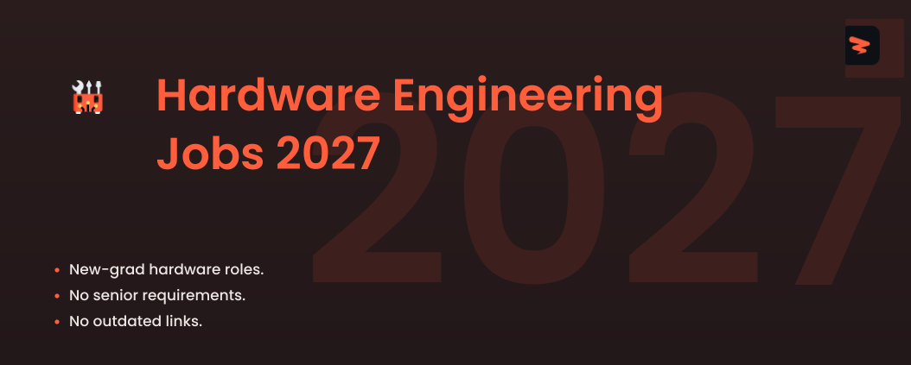

<!-- Cover -->

# Hardware Engineering Jobs 2027

🚀 Hardware, embedded systems, and EE jobs for new graduates, updated every 10 minutes.

  
  
  
  

---

## **Website & Autofill Extension**

Explore Zapply's website and check out:

- Our Chrome extension, which autofills job applications in seconds.
- A dedicated job board featuring the latest openings across various roles.
- User accounts with multiple profiles for different resume types and roles.
- Job application tracking with streaks and commitment awards.

Experience an advanced career journey with us! 🚀

  

## Explore Around

Connect and seek advice from a growing network of fellow students and new grads.

  
  &nbsp;&nbsp;
  

---

 

<h3>⚡ <strong>Hardware Engineer</strong></h3>

| Company | Role | Location | Posted | Visa | **Apply** |
|---------|------|----------|--------|------|----------|
| **Rolls-Royce** | Overhaul & Maintenance Methods Engineer | Indianapolis | 13m |  |  |
| **CACI** | DSP Communications Engineer | Colorado Springs, CO, US | 14m | ✅ Sponsor |  |
| **CACI** | Production Engineering Intern - Summer 2027 | Danbury, CT, US | 14m | ✅ Sponsor |  |
| **CACI** | Manufacturing Process Engineer | Orlando, FL, US | 14m | ✅ Sponsor |  |
| **Allegion** | Summer Intern - Advanced Manufacturing Engineering – Electrical Engineering | Carmel, IN | 14m |  |  |
| **ASML** | Mechatronics Engineer | Wilton, CT, USA | 14m | ✅ Sponsor |  |
| **ASML** | Electrical Engineer | Wilton, CT, USA | 14m | ✅ Sponsor |  |
| **ASML** | Mechanical Engineer - Electrical Packaging | Wilton, CT, USA | 14m | ✅ Sponsor |  |
| **Northrop Grumman** | Environmental Health & Safety Engineer Level 2 or 3 | United States-Utah-Corinne | 14m |  |  |
| **Northrop Grumman** | Engineering Technician Level 2 or Level 3 | United States-Arizona-Gilbert | 14m |  |  |
| **Northrop Grumman** | Mission Analyst Level 3 or 4 | United... | 14m |  |  |
| **Crane Co.** | Mechanical Engineer III - Actuation | Burbank, California | 14m | ✅ Sponsor |  |
| **Amgen** | Manufacturing Specialist-Process Engineer | Ohio - New Albany | 15m | ✅ Sponsor |  |
| **Genentech** | QMS Process Engineer | South San Francisco | 15m | ✅ Sponsor |  |
| **NVIDIA** | Technical Product Marketing Engineer, Robotics Simulation - New College Grad 2027 | US, CA, Santa Clara | 15m | ✅ Sponsor |  |
| **Onto Innovation** | Electrical Engineer 1 | Wilmington-MA | 15m | ✅ Sponsor |  |
| **Trane Technologies** | Intelligent Services Account Engineer | Maitland, Florida | 25m | ✅ Sponsor |  |
| **Trane Technologies** | Manufacturing Process Engineer | Forth Worth TX 15060 Blue Mound Rd | 25m | ✅ Sponsor |  |
| **Trane Technologies** | Commercial Airside Engineer | Lexington, Kentucky | 25m | ✅ Sponsor |  |
| **RTX** | Electrical Design Intern (Summer 2027) | CT-WINDSOR LOCKS-B1 | 25m | ✅ Sponsor |  |
| **RTX** | Materials and Process Engineer I | CA-EL SEGUNDO-E01 | 25m | ✅ Sponsor |  |
| **RTX** | Flight Controls Hardware Engineer I (Onsite) | IA-CEDAR RAPIDS | 25m | ✅ Sponsor |  |
| **Sierra Nevada Corporation** | RF Engineer Intern | Lone Tree, CO | 25m |  |  |
| **NREL** | Undergraduate/Graduate Intern (year-round) –Chemical Engineering/Biomass conversion/Catalytic... | Golden, CO | 25m | ✅ Sponsor |  |
| **Teledyne** | Video Engineer | Huntsville, AL | 34m |  |  |
| **Teledyne** | Applications Engineer | Goleta, CA | 34m |  |  |
| **Dexcom** | SW Development Engineer 1 | Remote California | 34m | ✅ Sponsor |  |
| **Danaher** | Field Service Engineer - Cleveland, OH | Cleveland, Ohio, United States | 35m | ✅ Sponsor |  |
| **Broadcom** | Field Applications Engineer | USA-CA San Jose Innovation Drive | 35m | ✅ Sponsor |  |
| **Etched** | Thermal Engineer, Rack Level | San Jose | 37m | ✅ Sponsor |  |
| **ALTEN Technology** | Exterior Trim Design Release Engineer | Long Beach, California, United... | 38m |  |  |
| **Apple** | Tactile Simulation Research Engineer - Special Projects (Robotics) | Santa Clara | 42m | ✅ Sponsor |  |
| **Apple** | Tactile AI Research Engineer - Special Projects (Robotics) | Santa Clara | 43m | ✅ Sponsor |  |
| **Apple** | Mechatronics Research Engineer - Special Projects (Robotics) | Santa Clara | 43m | ✅ Sponsor |  |
| **ALTEN Technology** | Underhood Trim Design Release Engineer | Long Beach, California, United... | 1h |  |  |
| **Generac** | Power System Controls Engineer | IL East Peoria | 1h | ✅ Sponsor |  |
| **Dow Jones** | AI Process Engineer - SOX Audit & Compliance | NYC | 1h | ✅ Sponsor |  |
| **Caterpillar** | Electrical Engineer – Critical Power Systems (Remote) | Georgia | 1h | ✅ Sponsor |  |
| **Caterpillar** | Automation & Controls Engineer - Critical Power Systems (Remote) | Georgia | 1h | ✅ Sponsor |  |
| **Caterpillar** | Electrical Controls Engineer - Critical Power Systems (Remote) | Georgia | 1h | ✅ Sponsor |  |
| **Boeing** | DSP Algorithms Engineer (Mid-Level or Lead) | USA - El Segundo, CA | 1h | ✅ Sponsor |  |
| **Boeing** | Experienced or Senior Mechanical System Design Engineers | Berkeley, MO | 1h | ✅ Sponsor |  |
| **Boeing** | Phantom Works Structural Analysis Engineer (Structural Analysis) | USA - Berkeley, MO | 1h | ✅ Sponsor |  |
| **MatX** | Hardware System Diagnostic Engineer | Mountain View ( | 1h |  |  |
| **Astreya** | IT Systems Operations Engineer | San Francisco, CA | 1h | ✅ Sponsor |  |
| **Astreya** | Network Operations Engineer II | Denver, CO | 1h | ✅ Sponsor |  |
| **Astreya** | Network Operations Engineer II | Denver, CO | 1h | ✅ Sponsor |  |
| **Trimble** | Mechanical Engineer | OH, Dayton | 1h | ✅ Sponsor |  |
| **Trimble** | Radio Frequency Engineer | CA, Sunnyvale | 1h | ✅ Sponsor |  |
| **Trimble** | Hardware Development Engineer | CA Sunnyvale | 1h | ✅ Sponsor |  |
| **General Motors** | Industrial Engineering | Arlington, Texas, United States... | 1h | ✅ Sponsor |  |
| **General Motors** | Compartment Integration Design Engineer | Warren, Michigan, United States... | 1h | ✅ Sponsor |  |
| **Rocket Lab** | Ground Systems Engineering Intern Summer 2027 | Stennis Space | 1h |  |  |
| **Philips** | Intern/Co-op - STET Mechanical Engineer – Latham, NY – Spring/Summer 2027 | Latham, New York, United States | 1h | ✅ Sponsor |  |
| **University of Texas at Austin** | Robotics and Autonomy Engineer (ES) | PICKLE RESEARCH | 1h |  |  |
| **Snap** | Product Design Engineer | Los Angeles California | 1h | ✅ Sponsor |  |
| **Carrier Global** | Mechanical Engineering Intern - Summer | CAN | 1h |  |  |
| **KLA** | Product Installation Engineer - FaST 90%+ Travel required | Chandler, AZ | 1h | ✅ Sponsor |  |
| **Cisco** | Mechanical Engineer II (Full-Time) - United States | San Jose, California, US | 1h | ✅ Sponsor |  |
| **SpaceX** | Mechanical Engineer (Starshield) | Hawthorne, CA | 1h | ✅ Sponsor |  |
| **SpaceX** | Automation & Controls Engineer (Starlink Optical Products) | Redmond, WA | 1h | ✅ Sponsor |  |
| **SpaceX** | Microelectronics Process Engineer (Optical Products) | Redmond, WA | 1h | ✅ Sponsor |  |
| **NXP** | Entry Level DFT Design Engineer | Austin | 1h | ✅ Sponsor |  |
| **Curtiss-Wright** | Process Engineer | TX-Round Rock | 1h |  |  |
| **Unisys** | Field Engineer Technician - Santa Clara | Santa Clara, CA, United States... | 1h | ✅ Sponsor |  |
| **Medtronic** | Engineering Technician III - Jacksonville | Jacksonville, Florida, United... | 1h | ✅ Sponsor |  |
| **General Motors** | Application Engineer - Virtual Extender | Milford, Michigan, United... | 2h | ✅ Sponsor |  |
| **Hitachi** | Mechanical Engineer | Michigan City, Indiana, United... | 2h | ✅ Sponsor |  |
| **TD Bank** | Audit Manager II  (Process Engineering) | Charlotte North Carolina | 2h | ✅ Sponsor |  |
| **Fresenius Medical Care** | R&D Engineering Co-op, Human Factors and Usability | Lawrence, MA, USA | 2h | ✅ Sponsor |  |
| **Vanguard** | Application Engineer - II | Malvern, PA | 2h | ✅ Sponsor |  |
| **Nissan** | Mechanical & Electrical Engineer Intern - Summer 2027 - Canton, MS | Canton, Mississippi - United... | 2h |  |  |
| **Nissan** | Industrial Engineering Intern - Summer 2027 - Smyrna, TN | Smyrna, Tennessee - United... | 2h |  |  |
| **Nissan** | Industrial Engineering Intern - Summer 2027 - Smyrna, TN | Smyrna, Tennessee - United... | 2h |  |  |
| **Viavi Solutions** | Manufacturing Process Engineer | Santa Rosa, CA USA | 2h | ✅ Sponsor |  |
| **KLA** | Optical Engineering Intern | Ann Arbor, MI | 2h | ✅ Sponsor |  |
| **KLA** | Electrical Hardware PCBA Engineer | Milpitas, CA | 2h | ✅ Sponsor |  |
| **GlobalFoundries** | Design Application Engineering | OFFSITE California | 2h | ✅ Sponsor |  |
| **GlobalFoundries** | Design Application Engineer | OFFSITE California | 2h | ✅ Sponsor |  |
| **GE Aerospace** | Weld Engineer | Norwich | 2h | ✅ Sponsor |  |
| **NVIDIA** | SWQA Tools Development Engineer | US, CA, Santa Clara | 2h | ✅ Sponsor |  |
| **NVIDIA** | Applied Machine Learning Engineer - AI for VLSI Design | US, CA, Santa Clara | 2h | ✅ Sponsor |  |
| **Regal Rexnord** | Application Engineer - Remote | ,,United States | 2h | ✅ Sponsor |  |
| **HP Inc** | Audio and DSP Development Engineering Intern | Scotts Valley, California,... | 2h | ✅ Sponsor |  |
| **AeroVironment** | Engineering Flight Test Specialist II | Melbourne, FL | 2h |  |  |
| **AeroVironment** | Mechanical Engineer II | Huntsville, AL | 2h |  |  |
| **AeroVironment** | Hardware Engineer - RF Systems | Sunrise, FL | 2h |  |  |
| **Thermo Fisher Scientific** | Process Engineer III | Ridgefield, New Jersey, USA | 2h | ✅ Sponsor |  |
| **ABB** | Electrification Services Application Engineer | CA Irvine | 2h | ✅ Sponsor |  |
| **Blue Origin** | Liquid System Responsible Engineer II — Cryogenic Fluids CAD & Design | Greater Seattle Area | 2h |  |  |
| **Blue Origin** | Structural Analyst III – Fluids & Propulsion – Crew Lunar Lander | Denver, CO | 2h |  |  |
| **Blue Origin** | Engineer - Fluid Systems Analyst | Huntsville, AL | 2h |  |  |
| **GE Vernova** | GE Vernova - Gas Power Field Engineering Intern - Summer 2027 | Schenectady | 3h | ✅ Sponsor |  |
| **GE Vernova** | Maintenance Reliability Engineer | Bangor | 3h | ✅ Sponsor |  |
| **VAST** | Build Reliability Engineer - Avionics | Long Beach, California, United... | 3h |  |  |
| **Stanley Black & Decker** | Mechanical Engineer III | East Longmeadow, MA, United States | 3h | ✅ Sponsor |  |
| **Moog** | Intern, Electrical Engineering | Buffalo, NY | 3h |  |  |
| **Micron Technology** | Global EHS Principle Safety Engineer | Boise ID Main Site | 3h | ✅ Sponsor |  |
| **VAST** | Build Reliability Engineer - Fluid Systems | Long Beach, California, United... | 3h |  |  |
| **Abbott** | Instrumentation/Automation Service Engineer I | United States - Wisconsin - Madison | 3h | ✅ Sponsor |  |

Apply for more jobs at

<h3>🔲 <strong>FPGA/ASIC</strong></h3>

| Company | Role | Location | Posted | Visa | **Apply** |
|---------|------|----------|--------|------|----------|
| **Pfizer** | Associate Scientist - Robotics & Automation, Vaccines | United States - New York -... | 14m | ✅ Sponsor |  |
| **NVIDIA** | ASIC Design Engineer – Clocks IP | CA Santa Clara | 15m | ✅ Sponsor |  |
| **Trane Technologies** | Associate Engineer | Lexington, Kentucky | 25m | ✅ Sponsor |  |
| **Broadcom** | ASIC Package Design Engineer | CA San Jose Innovation Drive | 35m | ✅ Sponsor |  |
| **Boeing** | DSP Comm Engineer (Associate or Mid-level) | USA - El Segundo, CA | 1h | ✅ Sponsor |  |
| **Boeing** | DSP Algorithms Engineer (Associate or Mid-Level) | USA - El Segundo, CA | 1h | ✅ Sponsor |  |
| **Boeing** | Government Training Engineering - Mechanical Design Engineer (Associate or Experienced) | Hazelwood, MO | 1h | ✅ Sponsor |  |
| **Carrier Global** | Associate Mechanical Engineer | CAI23: Carrier-Indianapolis,... | 1h |  |  |
| **Cisco** | ASIC Optical Hardware Systems Test Engineer | San Jose, California, US | 1h | ✅ Sponsor |  |
| **KBR** | Associate Structural Engineer | Houston, Texas | 2h | ✅ Sponsor |  |
| **Apple** | ASIC Design and Integration Engineer | Cupertino | 3h | ✅ Sponsor |  |
| **Northrop Grumman** | 2027 Associate Embedded Software Engineer Beavercreek Ohio | United States-Ohio-Beavercreek | 3h |  |  |
| **Apple** | ASIC Design and Integration Engineer | Cupertino | 3h | ✅ Sponsor |  |
| **Microsoft** | Firmware Engineer II | Hillsboro, Oregon, United States | 4h | ✅ Sponsor |  |
| **Microsoft** | SoC Hardware (Power Management) Validation Engineer | Hillsboro, Oregon, United States | 6h | ✅ Sponsor |  |
| **Voyant Photonics** | Embedded Firmware Engineer, Hardware Bring-up & Controls | New York | 11h |  |  |
| **Qualcomm** | Modem Firmware Engineer | San Diego, CA | 1d | ✅ Sponsor |  |
| **WSP** | Associate Consultant, Building Automation Controls Engineer | New York, NY, United States | 1d | ✅ Sponsor |  |
| **Cisco** | ASIC Optical Hardware Systems Test Engineer | San Jose, California | 1d | ✅ Sponsor |  |
| **MITRE** | Associate Embedded Security Engineer | Bedford, Massachusetts | 1d |  |  |
| **Warner Bros. Discovery** | Associate BIT Field Engineer | DC Washington 820 1st Street NE | 3d | ✅ Sponsor |  |
| **Warner Bros. Discovery** | Associate BIT Field Engineer | GA East Point | 3d | ✅ Sponsor |  |
| **Cisco** | ASIC Engineer (hybrid) | San Jose, California, US | 3d | ✅ Sponsor |  |
| **Apple** | Wireless RTL Design Engineer | Irvine | 3d | ✅ Sponsor |  |
| **Rockwell Automation** | Intern, Firmware Engineering | Milwaukee, Wisconsin, United States | 3d | ✅ Sponsor |  |
| **Carrier Global** | Associate Controls Engineer | CAG11: ALC Other HG, 1025 Cobb... | 3d |  |  |
| **Carrier Global** | Automated Logic- BAS/BMS Associate Field Engineer- Elkhart or La Porte, IN area | CAI31: ALC - Indiana, 117 North... | 3d |  |  |
| **BlackRock** | Associate, Application Engineer - Atlanta | Atlanta, GA | 3d | ✅ Sponsor |  |
| **Altera** | FPGA Design Applications Engineer | San Jose, California, United States | 3d | ✅ Sponsor |  |
| **Northrop Grumman** | 2027 Associate/ Embedded Software Engineer - Rolling Meadows IL | United States-Illinois-Rolling... | 3d |  |  |
| **Northrop Grumman** | 2027 Associate Mechanical Engineer/Mechanical Engineer - Dulles VA | United States-Virginia-Dulles | 3d |  |  |
| **Applied Materials** | FPGA Engineer IV | Rochester,NY | 3d | ✅ Sponsor |  |
| **Entegris** | Scientist I, Research Associate | Aurora, IL | 4d | ✅ Sponsor |  |
| **Trane Technologies** | Associate Engineer | Clarksville Tennessee | 4d | ✅ Sponsor |  |
| **RTX** | FPGA ENGINEER II | TX-MCKINNEY | 4d | ✅ Sponsor |  |
| **Amazon Data Services, Inc.** | Associate Physical Security Engineer, Data Center Design Engineering | Seattle, WA | 4d | ✅ Sponsor |  |
| **Qualcomm** | SoC Power Validation Engineer | San Diego, CA | 4d | ✅ Sponsor |  |
| **Qualcomm** | Associate PCB CAD Specialist | San Diego, CA | 4d | ✅ Sponsor |  |
| **Marvell** | Firmware Engineer | Santa Clara, CA | 4d | ✅ Sponsor |  |
| **NVIDIA** | ASIC Verification Engineer - GPU | CA Santa Clara | 4d | ✅ Sponsor |  |
| **Teledyne** | FPGA Design Engineer | Tucson, AZ | 4d |  |  |
| **Etched** | Internal Acceleration, Research Engineer (ASIC) | San Jose | 4d | ✅ Sponsor |  |
| **Etched** | Internal Acceleration, Engineer (ASIC) | San Jose | 4d | ✅ Sponsor |  |
| **Intel** | CPU RTL Design Engineer | Arizona Phoenix | 4d | ✅ Sponsor |  |
| **Intel** | Microarchitecture and Design Engineer - AI SoC | California Santa Clara | 4d | ✅ Sponsor |  |
| **Arrow Electronics** | Field Applications Engineer- FPGA | CA-San Jose, California | 4d | ✅ Sponsor |  |
| **Draper** | FPGA Design Engineer | Cambridge, MA | 4d |  |  |
| **AMD** | UEFI / BIOS Firmware Engineer | Austin, TX, United States | 4d | ✅ Sponsor |  |
| **Johnson Controls** | Linux Firmware Engineer | Westford-Massachusetts-United... | 4d | ✅ Sponsor |  |
| **Abbott** | Associate Quality Engineer | Puerto Rico - Arecibo | 4d | ✅ Sponsor |  |
| **Leidos** | Associate Substation Engineer | Charlotte, NC | 4d | ✅ Sponsor |  |
| **Microsoft** | Firmware Engineer | Redmond, Washington, United States | 4d | ✅ Sponsor |  |
| **MITRE** | Associate FPGA / ASIC Design Engineer - Summer 2027 | Bedford, Massachusetts | 5d |  |  |
| **NVIDIA** | ASIC Verification Engineer - New College Grad 2026 | TX Austin | 5d | ✅ Sponsor |  |
| **ABB** | Associate Mechanical Design Engineer | USA, NC, Mebane | 5d | ✅ Sponsor |  |
| **SpaceX** | FPGA Engineer (Starshield) | Hawthorne, CA | 5d | ✅ Sponsor |  |
| **Globus Medical** | Associate II, Field Service Engineering | Colorado | 5d | ✅ Sponsor |  |
| **Booz Allen Hamilton** | University - Spring 2027 Electronic Warfare FPGA Engineering Intern | Beavercreek, OH | 5d | ✅ Sponsor |  |
| **Draper** | Digital ASIC Design Engineer | Cambridge, MA | 5d |  |  |
| **Micron Technology** | New College Grad - Embedded Firmware Engineer | Boise, ID - SIG | 5d | ✅ Sponsor |  |
| **HARMAN International** | FPGA Engineer, Hardware & Electronics | Richardson - Texas, USA | 5d |  |  |
| **HP Inc** | Firmware Engineer BIOS/UEFI | Spring, Texas, United States of... | 5d | ✅ Sponsor |  |
| **Entegris** | Scientist II, Research Associate | Aurora, IL | 6d | ✅ Sponsor |  |
| **Entegris** | Scientist II, Research Associate | Aurora, IL | 6d | ✅ Sponsor |  |
| **Marvell** | Firmware Engineer Intern, BS - Summer 2027 | Santa Clara, CA | 6d | ✅ Sponsor |  |
| **NXP** | Static Timing Analysis Design Engineer / Physical Design | Austin | 6d | ✅ Sponsor |  |
| **NXP** | Static Timing Analysis Design Engineer / Physical Design | Austin | 6d | ✅ Sponsor |  |
| **Merck & Co.** | Associate Scientist, Chemical Engineering Research & Development (Onsite) | USA - New Jersey - Rahway | 6d | ✅ Sponsor |  |
| **Anduril** | 2027 Firmware Engineer Intern | Costa Mesa, California, United... | 6d |  |  |
| **KLA** | Associate Test Engineer 1 | Milpitas, CA | 6d | ✅ Sponsor |  |
| **Analog Devices** | Associate Test Engineer - Product Development | US, AZ, Chandler, East Elliot | 6d | ✅ Sponsor |  |
| **Rolls-Royce** | Digital Design and MBD/MBE Engineer | Indianapolis | 1w |  |  |
| **Pfizer** | Senior Associate Scientist, Upstream Process Development — Bioprocess Automation & Digitization | United States - Massachusetts -... | 1w | ✅ Sponsor |  |
| **HPE** | ASIC Verification Engineer | Sunnyvale, California, United... | 1w | ✅ Sponsor |  |
| **HPE (University)** | ASIC Intern | Sunnyvale, California, United... | 1w | ✅ Sponsor |  |
| **HPE (University)** | Firmware Engineering Intern | Sunnyvale, California, United... | 1w | ✅ Sponsor |  |
| **HPE (University)** | ASIC Verification Engineer | Sunnyvale, California, United... | 1w | ✅ Sponsor |  |
| **Amazon.com Services LLC** | ASIC Engineer Intern, Summer 2027 | Sunnyvale, CA | 1w | ✅ Sponsor |  |
| **Emerson Electric** | Firmware Engineer Co-Op | Marshalltown, IA, United States | 1w | ✅ Sponsor |  |
| **Atlantic Health System** | Instructor Basic Life Support (BLS) - Per Diem - Varied - Mobile Health | NJ, United States | 1w |  |  |
| **Sherwin-Williams** | Associate Full Stack Application Developer - Industrial Automation | Cleveland, OH, United States | 1w | ✅ Sponsor |  |
| **Caterpillar** | Associate Mechanical Engineer | Mossville, Illinois | 1w | ✅ Sponsor |  |
| **RTX** | FPGA Verification Engineer II (Onsite)- Active Secret | IN-FT WAYNE | 1w | ✅ Sponsor |  |
| **Analog Devices** | Associate Digital Design Engineer | CA San Jose Rio Robles | 1w | ✅ Sponsor |  |
| **Leidos** | Embedded Firmware Engineer | Huntsville, AL | 1w | ✅ Sponsor |  |
| **SpaceX** | ASIC Design Engineer (Silicon Engineering) | Palo Alto, CA | 1w | ✅ Sponsor |  |
| **MITRE** | Associate Signal Processing Engineer | Bedford, Massachusetts | 1w |  |  |
| **Zipline** | Firmware Engineer Intern (Summer 2027) | South San Francisco,... | 1w | ✅ Sponsor |  |
| **Zipline** | Firmware Engineer Intern (Spring 2027) | South San Francisco,... | 1w | ✅ Sponsor |  |
| **GE Aerospace** | Entry Level - FPGA Design/Verification Engineer | Grand Rapids | 1w | ✅ Sponsor |  |
| **ASML** | FPGA Design and Verification Engineer | Wilton, CT, USA | 1w | ✅ Sponsor |  |
| **Nokia** | SoC/FPGA Engineer 2 | United States | 1w | ✅ Sponsor |  |
| **University of Texas at Austin** | Embedded Electronics and Robotics Engineering Associate | PICKLE RESEARCH | 1w |  |  |
| **Moog** | Associate Product Engineer | Niagara Falls, NY | 1w |  |  |
| **Moog** | Associate Design Engineer, PWB Design | Buffalo, NY | 1w |  |  |
| **Analog Devices** | Associate Analog Design Engineer | AZ Chandler East Elliot | 1w | ✅ Sponsor |  |
| **Harbinger Motors** | Associate Design Release Engineer, LV | Garden Grove, CA | 1w | ✅ Sponsor |  |
| **Google** | SoC DFT Engineer, Cloud | United States | Date unknown | ✅ Sponsor |  |
| **Entrust** | Firmware Engineering Co-op | MN | 1w | ✅ Sponsor |  |
| **Generac** | Firmware Engineer III | Waukesha, WI - USA | 1w | ✅ Sponsor |  |

Apply for more jobs at

<h3>🔌 <strong>Embedded Systems</strong></h3>

| Company | Role | Location | Posted | Visa | **Apply** |
|---------|------|----------|--------|------|----------|
| **Becton Dickinson** | Product Security Engineer -  Embedded | USA CA - Irvine Laguna Canyon | 1h | ✅ Sponsor |  |
| **General Motors** | Engineering Supervisor - ECU Software Flashing & Embedded Systems | Warren, Michigan, United States... | 2h |  |  |
| **Aerospace Corporation** | Embedded Software Engineer (mid level) | El Segundo, CA | 4d |  |  |
| **Aerospace Corporation** | Small Satellite Embedded Software Engineer | El Segundo, CA | 4d |  |  |
| **Blue Origin** | Embedded Controls Engineer - Lunar Avionics | Greater Seattle Area | 4d |  |  |
| **JLL** | BMS Controls Engineer /IoT Operations SME | Atlanta, GA | 4d | ✅ Sponsor |  |
| **Northrop Grumman** | Embedded Software Engineer – Level 2 | United States-Virginia-Dulles | 4d |  |  |
| **Northrop Grumman** | Mgr. Embedded Software Engineer 3 | United States-Maryland-Baltimore | 4d |  |  |
| **Northrop Grumman** | 2027 S/W Embedded Engineering Intern – Annapolis MD | United States-Maryland-Annapolis | 5d |  |  |
| **Analog Devices** | Applications Engineer - Embedded Systems, Digital Communications, High Speed Converters | US, MA, Wilmington | 5d | ✅ Sponsor |  |
| **HP Inc** | Linux/Android Embedded Firmware Developer | Austin, Texas, United States of... | 5d | ✅ Sponsor |  |
| **Bose** | Embedded Audio ML Engineer Co-op | US, MA - Framingham | 6d | ✅ Sponsor |  |
| **Apple** | Embedded Software Engineer - Biophotonics | Cupertino | 6d | ✅ Sponsor |  |
| **Apple** | Embedded Software Engineer - Biophotonics | Cupertino | 6d | ✅ Sponsor |  |
| **SharkNinja** | Manager, Embedded Firmware Architecture | Needham, MA, United States | 6d | ✅ Sponsor |  |
| **Apple** | Camera Embedded Software Engineer | Cupertino | 6d | ✅ Sponsor |  |
| **Blue Origin** | MK1 Embedded Controllers Test Engineer II | Greater Seattle Area | 1w |  |  |
| **NVIDIA** | Field Applications Engineer, Embedded Systems - NALA | US, CA, Santa Clara | 1w | ✅ Sponsor |  |
| **CACI** | Embedded Linux Engineer | Remote | 1w | ✅ Sponsor |  |
| **MITRE** | Intermediate Embedded Security Engineer | Bedford, Massachusetts | 1w |  |  |
| **NXP** | Field Application Engineer - Microcontrollers | San Jose | 1w | ✅ Sponsor |  |
| **Arrow Electronics** | Embedded Engineer (eInfochip Inc) | Santa Clara,CA | 1w | ✅ Sponsor |  |
| **Arrow Electronics** | Embedded Engineer (eInfochip Inc) | Santa Clara,CA | 1w | ✅ Sponsor |  |
| **Micron Technology** | Intern - SSD Firmware - CICD | Longmont-MAX- | 1w | ✅ Sponsor |  |
| **Analog Devices** | Embedded AI Tools Engineer | US, MA, Wilmington | 1w | ✅ Sponsor |  |
| **Agility Robotics** | Firmware Manager | Hybrid- Fremont, CA | 1w | ✅ Sponsor |  |
| **ASML** | Embedded Software Engineer | Wilton, CT, USA | 1w | ✅ Sponsor |  |
| **Booz Allen Hamilton** | Embedded Developer | El Segundo, CA | 1w | ✅ Sponsor |  |
| **RTX** | Embedded Controls Hardware Co-Op (Winter/Spring 2027) | IL-ROCKFORD-P6 | 1w | ✅ Sponsor |  |
| **RTX** | Embedded Controls Hardware Co-Op (Summer/Fall 2027) | IL-ROCKFORD-P6 | 1w | ✅ Sponsor |  |
| **Amazon.com Services LLC - A57** | Embedded Firmware Co-op, Amazon Robotics - Spring 2027 | North Reading, MA | 1w | ✅ Sponsor |  |
| **Analog Devices** | Firmware Field Applications Engineer - Hyperscaler Data Center Accounts | US, CA, San Jose, Rio Robles | 1w | ✅ Sponsor |  |
| **AMD** | Firmware Systems Design Engineer | Austin, TX, United States | 1w | ✅ Sponsor |  |
| **Axon** | Firmware Validation Engineer I (Onsite) | Scottsdale, Arizona, United States | 2w |  |  |
| **Leidos** | Embedded Design Engineering Intern – Firmware | Huntsville, AL | 2w | ✅ Sponsor |  |
| **iRhythm** | Firmware Quality Assurance Engineer Co-Op Intern Full Time January-June | San Francisco, CA | 3w |  |  |
| **Philips** | Intern – Embedded Systems Test Automation Engineer – Bothell, WA – Summer 2027 | Bothell, Washington, United States | 3w | ✅ Sponsor |  |
| **iRhythm** | Embedded SDET Co-Op Full Time Intern January-June 2027 | San Francisco, CA | 3w |  |  |
| **Stanley Black & Decker** | Embedded Engineering Summer Intern 2027 | Towson, MD, United States | 3w | ✅ Sponsor |  |
| **Qualcomm** | Embedded Engineering Internship - Summer 2027 | San Diego, CA | 4w | ✅ Sponsor |  |
| **Penn State University** | Embedded Systems and Hardware Co-Op | Warminster, PA | 1mo |  |  |
| **Micron Technology** | Intern - Data Center SSD Firmware | Longmont-MAX- | 1mo | ✅ Sponsor |  |
| **AMD** | Embedded Firmware Development Engineer | Austin, TX, United States | 1mo | ✅ Sponsor |  |
| **RTX** | Electrical Firmware (Winter/Spring Co-op)(Onsite) | IA-CEDAR RAPIDS | 1mo | ✅ Sponsor |  |
| **Flagship Pioneering** | Pioneering Intelligence: Data Science Co-Op (Embedded Science Team) | Cambridge, MA USA | 1mo |  |  |
| **NXP** | Embedded Machine Learning & Radar Processing Intern - Summer 2027 | San Jose | 1mo | ✅ Sponsor |  |
| **MITRE** | Embedded Security Intern - Electronics Prototype | Bedford, Massachusetts | 1mo |  |  |
| **AMD** | FAE - Embedded x86 Specialist | Austin, TX, United States | 1mo | ✅ Sponsor |  |
| **Honeywell** | Embedded Engineer - Summer 2027 Intern (US Person Required) | United States | 1mo | ✅ Sponsor |  |
| **Honeywell** | Embedded Engineer - Summer 2027 Intern | United States | 1mo | ✅ Sponsor |  |
| **ALTEN Technology** | Automotive Firmware Validation Engineer | Foster City, California, United... | 2mo |  |  |
| **Redwood Materials** | Embedded Software Engineer – Power Electronics, Energy Storage | San Francisco, California,... | 3mo | ✅ Sponsor |  |
| **DoorDash** | Firmware Validation & Integration Engineer | San Francisco, CA | 4mo | ✅ Sponsor |  |
| **Neros Technologies** | Firmware Test Engineer | Torrance, California, United States | 12mo |  |  |
| **Cresta** | Embedded AI Expert | United States (Remote) | 13mo |  |  |
| **Accenture Federal Services** | Embedded Developer II | Annapolis Junction, MD | 16mo |  |  |

Apply for more jobs at

<h3>🔋 <strong>Electrical Engineer</strong></h3>

| Company | Role | Location | Posted | Visa | **Apply** |
|---------|------|----------|--------|------|----------|
| **Rolls-Royce** | Electronics Test Engineering Specialist | West Lafayette | 13m |  |  |
| **CACI** | Test Engineer (SME) | Ashburn, VA, US | 14m | ✅ Sponsor |  |
| **RTX** | Electrical Design Engineer Intern (Summer 2027) | CT-WINDSOR LOCKS-B1 | 25m | ✅ Sponsor |  |
| **Teledyne** | Test Engineer | Goleta, CA | 34m |  |  |
| **General Motors** | 2027 Summer Intern, Fleet Reliability & Test Engineering, ASD | Milford, Michigan, United... | 1h | ✅ Sponsor |  |
| **Snap** | Integrated Circuit Design Verification Engineer | Vancouver, WA | 1h | ✅ Sponsor |  |
| **Carrier Global** | Test Engineering Intern - Summer | CAI19: UTEC-Huntington, 111... | 1h |  |  |
| **Elanco** | Validation Engineer | Elwood, KS | 1h | ✅ Sponsor |  |
| **Skydio** | Flight Test Engineer - Camera Quality | San Mateo, California, United... | 1h | ✅ Sponsor |  |
| **Caterpillar** | MWL Validation Engineer | Peoria, Illinois | 2h | ✅ Sponsor |  |
| **Oshkosh Corporation** | Fluid Power Engineer Intern | Oshkosh, Wisconsin, United States | 2h | ✅ Sponsor |  |
| **AeroVironment** | Environmental System Test Engineer II | Moorpark, CA | 2h |  |  |
| **Blue Origin** | Test Engineer III – Motion Control, Honeybee Robotics, EGSE & Test Software | Longmont, CO | 2h |  |  |
| **Blue Origin** | Test Engineer III – Motion Control, Honeybee Robotics (EGSE & Test Software) | Longmont, CO | 2h |  |  |
| **GE Vernova** | GE Vernova Component & Development Test Engineer | Greenville | 3h | ✅ Sponsor |  |
| **SpaceX** | Propulsion Test Engineer (Raptor Components) | Hawthorne, CA | 3h | ✅ Sponsor |  |
| **Jabil** | Test Engineer Technician II | San Jose, CA | 4h | ✅ Sponsor |  |
| **Jabil** | Test Engineer Technician II | San Jose, CA | 4h | ✅ Sponsor |  |
| **Relativity Space** | Manufacturing Test Engineer II, Electromechanical Systems | Long Beach, California, United... | 4h | ✅ Sponsor |  |
| **JLL** | Weekly Test Engineer | Birmingham, GBR | 4h | ✅ Sponsor |  |
| **Relativity Space** | Manufacturing Test Engineer II, Electromechanical Mechanisms | Long Beach, California, United... | 4h | ✅ Sponsor |  |
| **Varda Space** | Mechanical Design & Test Engineer II, Automation | El Segundo, California, United... | 5h |  |  |
| **Anduril** | 2027 Field Test Engineer Intern | Costa Mesa, California, United... | 5h |  |  |
| **Leidos** | Systems Integration & Test Engineer | Gaithersburg, MD | 8h | ✅ Sponsor |  |
| **Schweitzer Engineering Laboratories** | Test Engineering Technician I - First Shift | Indiana - West Lafayette | Date unknown | ✅ Sponsor |  |
| **Schweitzer Engineering Laboratories** | Test Engineering Technician I - Swing Shift | Indiana - West Lafayette | Date unknown | ✅ Sponsor |  |
| **ALTEN Technology** | Trim Validation Engineer | Foster City, California, United... | 2d |  |  |
| **Sierra Nevada Corporation** | Test Engineer II | Lone Tree, CO | 3d |  |  |
| **RTX** | Manufacturing Test Engineer (On-site) | CT-WINDSOR LOCKS-B1 | 3d | ✅ Sponsor |  |
| **Broadcom** | Test Engineer (ATE) | USA-CA San Jose Innovation Drive | 3d | ✅ Sponsor |  |
| **Apple** | Wireless Module Test Engineer | Sunnyvale | 3d | ✅ Sponsor |  |
| **General Motors** | Hardware Development and Validation Engineer – Fuel Injector Test Benches | Pontiac, Michigan, United... | 3d | ✅ Sponsor |  |
| **Caterpillar** | Power Electronics Core Component Development Engineer | Mossville, Illinois | 3d | ✅ Sponsor |  |
| **Apple** | Wireless Module Test Engineer | Sunnyvale | 3d | ✅ Sponsor |  |
| **Apple** | Wireless Module Test Engineer | Sunnyvale | 3d | ✅ Sponsor |  |
| **AeroVironment** | Test Engineer II | West Valley City, UT | 3d |  |  |
| **ABB** | Power Electronics Scientist | USA, NC, Raleigh | 3d | ✅ Sponsor |  |
| **Blue Origin** | Electrical Test Engineer I - Lunar Permanence | Space Coast, FL | 3d |  |  |
| **Moog** | Test Engineer | Blacksburg, VA | 3d |  |  |
| **Intel** | GPU Validation Engineer | California Folsom | 3d | ✅ Sponsor |  |
| **Intel** | Circuit Design Engineer | US, California, Folsom | 3d | ✅ Sponsor |  |
| **Northrop Grumman** | Test Engineer Level 2/3 (AHT) | United States-California-Northridge | 3d |  |  |
| **SpaceX** | Mechanical Integration & Test Engineer, User Products (Starshield) | Hawthorne, CA | 3d | ✅ Sponsor |  |
| **SpaceX** | Wifi & RF Compliance Test Engineer (Starlink) | Bastrop, TX | 3d | ✅ Sponsor |  |
| **CACI** | Test Engineer Analyst | Remote | 4d | ✅ Sponsor |  |
| **Mach Industries** | Mechanical Test Engineer | Huntington Beach, California,... | 4d |  |  |
| **Sierra Nevada Corporation** | Test Engineer II | Southern Pines, NC | 4d |  |  |
| **Sierra Nevada Corporation** | Test Engineer II | Southern Pines, NC | 4d |  |  |
| **RTX** | Reliability Analyst & Test Engineer 1 (Onsite) | FL-MELBOURNE | 4d | ✅ Sponsor |  |
| **Qualcomm** | PST Validation Engineer | San Diego, CA | 4d | ✅ Sponsor |  |
| **Philips** | Electrical Design Engineer 3 | Gainesville, Florida, United States | 4d | ✅ Sponsor |  |
| **Cadence** | Custom Layout Designer (Analog Layout Designer) | CARY | 4d |  |  |
| **General Motors** | Software Controls Engineer - Power Electronics | Milford, Michigan, United... | 4d | ✅ Sponsor |  |
| **Booz Allen Hamilton** | Lab Technician and Test Engineer | Kirtland AFB, NM | 4d | ✅ Sponsor |  |
| **Booz Allen Hamilton** | Lab Technician & Test Engineer | Kirtland AFB, NM | 4d | ✅ Sponsor |  |
| **Micron Technology** | New College Grad - Product Test Engineer | Boise, ID - Main Site | 4d | ✅ Sponsor |  |
| **Anduril** | Assembly Integration and Test Engineer, Space Systems | Costa Mesa, California, United... | 4d |  |  |
| **Jabil** | Test Engineer - Liquid Cooling | Florence, KY | 4d | ✅ Sponsor |  |
| **Schweitzer Engineering Laboratories** | Test Engineer | Indiana - West Lafayette | Date unknown | ✅ Sponsor |  |
| **Relativity Space** | Integration & Test Engineer II, 2nd shift | Long Beach, California, United... | 4d | ✅ Sponsor |  |
| **Applied Materials** | RF Power Systems Test Engineer | Austin,TX | 4d | ✅ Sponsor |  |
| **Mach Industries** | Thermal Test Engineer | Huntington Beach, California,... | 4d |  |  |
| **Google** | EMC Test Engineer, Platforms Infrastructure Engineering | United States | Date unknown | ✅ Sponsor |  |
| **Rocket Lab** | Integration & Test Engineer II | Long Beach, CA | 4d |  |  |
| **Anduril** | Hardware Test Engineer | Lexington, Massachusetts,... | 4d |  |  |
| **Cisco** | Photonic Design Verification Test Engineer | Holmdel, New Jersey, US | 4d | ✅ Sponsor |  |
| **Muon Space** | RF Test Engineer I, Testbeds & EGSE | San Jose, CA | 4d |  |  |
| **Intel** | CPU Validation Engineer | US, Texas, Austin | 4d | ✅ Sponsor |  |
| **ASML** | System Integration and Test Engineer Back End Nights ( 6:00 PM – 6:00 AM (Wednesday, Thursday,... | Wilton, CT, USA | 5d | ✅ Sponsor |  |
| **Leidos** | Mid-Level Test Engineer | Gaithersburg, MD | 5d | ✅ Sponsor |  |
| **Navarro** | Test Engineer (4017) | Oak Ridge, Tennessee | 5d |  |  |
| **Qualcomm** | Pre-Silicon Validation Engineer | San Diego, CA | 5d | ✅ Sponsor |  |
| **Qualcomm** | Near-Memory Compute System Validation Engineer | San Diego, CA | 5d | ✅ Sponsor |  |
| **Texas Instruments** | Validation Engineer | Dallas, TX, United States | 5d | ✅ Sponsor |  |
| **Nokia** | Photonic Test Engineer | United States | 5d | ✅ Sponsor |  |
| **Cisco** | Photonic Design Verification Test Engineer | Holmdel, New Jersey | 5d | ✅ Sponsor |  |
| **Rockwell Automation** | Intern, Test Engineering (Milwaukee, WI) | Milwaukee, Wisconsin, United States | 5d | ✅ Sponsor |  |
| **AeroVironment** | System Test Engineer I | Moorpark, CA | 5d |  |  |
| **AMD** | Cores Systems Validation Engineer | Austin, TX, United States | 5d | ✅ Sponsor |  |
| **Northrop Grumman** | Electrical Design Engineer Level 2 / 3 | United States-California-Sunnyvale | 5d |  |  |
| **Northrop Grumman** | Electrical Integration & Test Engineer (Level 3 or 4) | United States-Arizona-Chandler | 5d |  |  |
| **Motorola Solutions** | Test Engineer | Greater Chicago Area | 5d | ✅ Sponsor |  |
| **Muon Space** | RF Test Engineer II, Testbeds & EGSE | San Jose, CA | 5d |  |  |
| **Rocket Lab** | Integration & Test Engineer I | Long Beach, CA | 5d |  |  |
| **HPE** | Systems Test Engineer | Spring, Texas, United States of... | 6d | ✅ Sponsor |  |
| **HPE (University)** | Systems Test Engineer | Spring, Texas, United States of... | 6d | ✅ Sponsor |  |
| **Leidos** | Electro-Optical Test Engineer | Beavercreek, OH | 6d | ✅ Sponsor |  |
| **Broadcom** | Test Engineer – Silicon Photonics | USA-Pennsylvania-Breinigsville | 6d | ✅ Sponsor |  |
| **Amazon Data Services, Inc.** | Electrical Design Engineer, Data Center Design Engineering, Data Center Design Engineering | Herndon, VA | 6d | ✅ Sponsor |  |
| **BAE Systems** | Test Engineer II - Microwave | Nashua, New Hampshire | 6d |  |  |
| **Philips** | R&D Test Engineer, Ultrasound (Cambridge, MA) | Cambridge (US), Massachusetts,... | 6d | ✅ Sponsor |  |
| **ALTEN Technology** | Electrical Test Engineer, High Voltage Zonal Module | Long Beach, California | 6d |  |  |
| **NVIDIA** | Optical Package Test Engineer | US, CA, Santa Clara | 6d | ✅ Sponsor |  |
| **NVIDIA** | Silicon Validation Engineer | US, CA, Santa Clara | 6d | ✅ Sponsor |  |
| **NVIDIA** | SRAM Circuit Design Engineer - New College Grad 2026 | US, CA, Santa Clara | 6d | ✅ Sponsor |  |
| **Teledyne** | Test Engineer | Garland, TX | 6d |  |  |
| **Teledyne** | Test Engineer Manager | Garland, TX | 6d |  |  |
| **Amentum** | Propulsion Test Engineer (ES2) | AL-Huntsville | 6d |  |  |
| **Draper** | Integration and Test Engineer | Cambridge, MA | 6d |  |  |
| **Crusoe** | Electrical Design Engineer | Bellevue, WA - US | 6d | ✅ Sponsor |  |

Apply for more jobs at

<h3>✅ <strong>Validation Engineer</strong></h3>

| Company | Role | Location | Posted | Visa | **Apply** |
|---------|------|----------|--------|------|----------|
| **ASML** | NXE Factory Quality Engineer | Wilton, CT, USA | 14m | ✅ Sponsor |  |
| **Micron Technology** | Customer Quality Engineer | Longmont-MAX- | 14m | ✅ Sponsor |  |
| **Johnson & Johnson** | Quality Engineering Co-Op, Summer 2027 | Cincinnati, Ohio, United States... | 14m | ✅ Sponsor |  |
| **Magna** | Quality Engineer | Lowell, Massachusetts, US | 24m | ✅ Sponsor |  |
| **Trane Technologies** | Mission Critical Customer Quality Engineer | Grand Rapids, Michigan | 25m | ✅ Sponsor |  |
| **RTX** | Customer Quality Engineering Co-Op (Summer/Fall 2027) | MN-BURNSVILLE-NORTH | 35m | ✅ Sponsor |  |
| **Brunswick** | Supplier Quality Engineer | Brownsburg, IN | 1h | ✅ Sponsor |  |
| **Trimble** | Hardware Testing Engineer | CA, Sunnyvale | 1h | ✅ Sponsor |  |
| **Trimble** | Hardware Testing Engineer | OH, Dayton | 1h | ✅ Sponsor |  |
| **Carrier Global** | Quality Engineering Intern - Summer | CAN01: Carrier-Syracuse, 6304... | 1h |  |  |
| **Medtronic** | Quality Engineer II | Fridley, Minnesota, United... | 1h | ✅ Sponsor |  |
| **Becton Dickinson** | Quality Engineer II, Instrument Plant | USA MD - Sparks | 1h | ✅ Sponsor |  |
| **Becton Dickinson** | Quality Engineer – Quality ERP Integration (SAP Quality Module) | USA MD - Sparks | 1h | ✅ Sponsor |  |
| **General Motors** | Manufacturing Quality Engineer - Rochester | Rochester, New York, United... | 2h | ✅ Sponsor |  |
| **Hitachi** | Quality Engineer I | (HPES) Pleasanton, CA | 2h | ✅ Sponsor |  |
| **Graco** | Quality Engineer - QMS | Rogers, Minnesota, USA | 2h | ✅ Sponsor |  |
| **Daimler Truck** | Strategic Supplier Quality Engineer | Detroit, MI US | 2h |  |  |
| **Blue Origin** | Production Quality Engineer (Machine Shop) | Huntsville, AL | 2h |  |  |
| **Blue Origin** | Supplier Quality Engineer III | Los Angeles, CA | 2h |  |  |
| **Blue Origin** | Supplier Quality Engineer III | Space Coast, FL | 2h |  |  |
| **Northrop Grumman** | 2026 Supplier Quality Engineer - Level 1 or Level 2 - Promontory UT | United States-Utah-Corinne | 3h |  |  |
| **Saronic Technologies** | Supplier Quality Engineer | Austin, TX | 4h |  |  |
| **Jabil** | Quality Engineer, Electronics/Manufacturing | Florence, KY | 5h | ✅ Sponsor |  |
| **Jabil** | Cloud Test Development Engineer | Florence, KY | 5h | ✅ Sponsor |  |
| **Magna** | Supplier Quality Engineer | Moore, South Carolina, US | 1d | ✅ Sponsor |  |
| **Magna** | Quality Engineer | Moore, South Carolina, US | 1d | ✅ Sponsor |  |
| **RTX** | Design Quality Engineer II onsite Andover, MA | MA-ANDOVER-AN0 | 1d | ✅ Sponsor |  |
| **AMAX** | Quality Engineer | Fremont, California | 1d |  |  |
| **JPMorgan Chase** | Technology Support III - Quality Engineering, ISO 20022 | Tampa, FL, United States | 1d | ✅ Sponsor |  |
| **Shield AI** | Engineer I, Mechanical Hardware Test | Seattle, Washington | 2d | ✅ Sponsor |  |
| **Nidec** | Customer Quality Engineer | North America/USA/Illinois/St.... | 3d | ✅ Sponsor |  |
| **ASML** | Manufacturing Quality Engineer – Optics | Wilton, CT, USA | 3d | ✅ Sponsor |  |
| **RTX** | Quality Engineer II | MN-BURNSVILLE-WEST | 3d | ✅ Sponsor |  |
| **Philips** | Quality Engineer 1 | Colorado Springs, Colorado,... | 3d | ✅ Sponsor |  |
| **GlobalFoundries** | Silicon Photonics Test Development Engineer (2027 New College Graduate) | USA - Vermont - Essex Junction | 3d | ✅ Sponsor |  |
| **Guidehouse** | Quality Assurance System Tester | Remote | 3d | ✅ Sponsor |  |
| **ABB** | Supplier Quality Engineer Intern | New Berlin, Wisconsin, United... | 3d | ✅ Sponsor |  |
| **Becton Dickinson** | Quality Engineering Technician | USA SC - Sumter | 3d | ✅ Sponsor |  |
| **Northrop Grumman** | Quality Engineer Level 2 or 3 | United States-Utah-Magna | 3d |  |  |
| **Northrop Grumman** | Quality Engineer Manager 2 | United States-California-Oxnard | 3d |  |  |
| **Johnson Controls** | Quality Engineer - Weekend Shift | San Antonio-Texas-United States... | 3d | ✅ Sponsor |  |
| **Abbott** | Development Quality Engineer I | United States - California - Sylmar | 3d | ✅ Sponsor |  |
| **Johnson & Johnson** | Quality Engineering Co-op– Spring 2027 | Cincinnati, Ohio, United States... | 3d | ✅ Sponsor |  |
| **Jabil** | Quality Engineering Tech III, Liquid Cooling | Florence, KY | 3d | ✅ Sponsor |  |
| **ALTEN Technology** | Supplier Quality Engineer (SQE) | Toledo, Ohio, United States | 3d |  |  |
| **Nidec** | Process Quality Engineer | North America/USA/Illinois/St.... | 4d | ✅ Sponsor |  |
| **Trane Technologies** | Sourced Products Supplier Quality Engineer | Lexington Kentucky | 4d | ✅ Sponsor |  |
| **Sierra Nevada Corporation** | Program Quality Engineer II | Dayton, OH | 4d |  |  |
| **Sierra Nevada Corporation** | Program Quality Engineer III | Dayton, OH | 4d |  |  |
| **BorgWarner** | Supplier Quality Engineer (Battery Energy Systems) | Seneca - South Carolina - USA | 4d | ✅ Sponsor |  |
| **Brunswick** | Supplier Quality Engineer - Paint & Further Processing | Fond du Lac, WI | 4d | ✅ Sponsor |  |
| **Boeing** | Experienced Quality Engineer (Core Quality) | USA - Ridley Park, PA | 4d | ✅ Sponsor |  |
| **Amazon Kuiper Manufacturing Enterprises LLC** | HW Test Development Engineer, Amazon LEO | Redmond, WA | 4d | ✅ Sponsor |  |
| **AES Corporation** | Robotics Validation & Release Engineer | US, Arlington, VA | 4d | ✅ Sponsor |  |
| **Monolithic Power Systems** | Customer Quality Engineer | San Jose, CA | 4d | ✅ Sponsor |  |
| **Fresenius Medical Care** | Supplier Quality Engineer I | Knoxville, TN, USA | 4d | ✅ Sponsor |  |
| **Oshkosh Corporation** | Quality Engineer | Bradenton, Florida, United States | 4d | ✅ Sponsor |  |
| **Guidehouse** | Quality Assurance System Tester | VA, McLean | 4d | ✅ Sponsor |  |
| **Adtran** | Quality Engineer | Adtran Huntsville | 4d | ✅ Sponsor |  |
| **KION Group** | Product Quality Engineer | Grand Rapids MI United States | 4d |  |  |
| **Zipline** | Hardware Test Technician, Avionics | South San Francisco,... | 4d | ✅ Sponsor |  |
| **Leidos** | Quality Engineer | Orlando, FL | 4d | ✅ Sponsor |  |
| **Anduril** | Product Quality Engineer, Dive-LD | Quonset, Rhode Island, United... | 4d |  |  |
| **Cisco** | Semiconductor Packaging Component Quality Engineer | San Jose, California, US | 5d | ✅ Sponsor |  |
| **Harbinger Motors** | Quality Engineer, Quality Management Systems | Garden Grove, CA | 5d | ✅ Sponsor |  |
| **Baxter International** | Quality Engineer | Thetford, Norfolk | 5d |  |  |
| **Abbott** | Quality Engineer | Puerto Rico - Caguas | 5d | ✅ Sponsor |  |
| **Crane Co.** | Supplier Quality Engineer II/III | Lynnwood, Washington | 6d | ✅ Sponsor |  |
| **Generac** | Quality Engineering Specialist II | Holdrege, NE - USA | 6d | ✅ Sponsor |  |
| **Polaris** | Electrical System Quality Engineer | Wyoming, MN, USA | 6d |  |  |
| **Cummins** | Global Mfg. Quality Engineer-Welding Specialist | Indianapolis, IN, United States | 6d | ✅ Sponsor |  |
| **Cisco** | Semiconductor Packaging Component Quality Engineer | San Jose, California | 6d | ✅ Sponsor |  |
| **Apple** | Manufacturing Quality Engineer - Brittles | Cupertino | 6d | ✅ Sponsor |  |
| **Curtiss-Wright** | Supplier Quality Engineer - Remote | NY Work | 6d |  |  |
| **Medtronic** | Supplier Quality Engineer II | State of Minnesota, United... | 6d | ✅ Sponsor |  |
| **Medtronic** | Supplier Quality Engineer II | Memphis, Tennessee, United... | 6d | ✅ Sponsor |  |
| **General Motors** | Supplier Quality Engineer - Plant Support | Concord, North Carolina, United... | 6d | ✅ Sponsor |  |
| **General Motors** | Quality Engineer | Spring Hill, Tennessee, United... | 6d | ✅ Sponsor |  |
| **Caterpillar** | Quality Engineer - Metrology | Pontiac, Illinois | 6d | ✅ Sponsor |  |
| **Analog Devices** | 1st Shift Quality Engineer | US, MA, Chelmsford, Alpha | 6d | ✅ Sponsor |  |
| **Harbinger Motors** | Quality Engineer, Electrical | Garden Grove, CA | 6d | ✅ Sponsor |  |
| **Harbinger Motors** | Supplier Quality Engineer, Cabin | Garden Grove, CA | 6d | ✅ Sponsor |  |
| **Abbott** | Electrical Development Quality Engineer II | United States - California - Sylmar | 6d | ✅ Sponsor |  |
| **Fresenius Medical Care** | Quality Engineer II | Bogotá, CUN, CO | 6d | ✅ Sponsor |  |
| **LLNL** | Quality Engineer/Weapon Production Quality | Livermore, CA | 6d | ✅ Sponsor |  |
| **Trane Technologies** | Field Quality Engineer | Columbia, South Carolina | 1w | ✅ Sponsor |  |
| **BorgWarner** | Supplier Quality Engineer | Ithaca - New York - USA | 1w | ✅ Sponsor |  |
| **Generac** | Quality Engineering Specialist II | Eagle, WI - USA | 1w | ✅ Sponsor |  |
| **Avnet** | Quality Engineer | Chandler, Arizona, United... | 1w | ✅ Sponsor |  |
| **Emerson Electric** | Quality Engineering Co-op | Marshalltown, IA, United States | 1w | ✅ Sponsor |  |
| **Fortive** | Supplier Quality Engineer | Pittsburgh, PA, United States | 1w |  |  |
| **Vertiv** | Manufacturing Quality Engineer | Ironton, OH, United States | 1w | ✅ Sponsor |  |
| **Applied Materials** | Operations and Customer Quality Engineer II - (E2) | Austin,TX | 1w | ✅ Sponsor |  |
| **Applied Materials** | Operations and Customer Quality Engineer | Kalispell,MT | 1w | ✅ Sponsor |  |
| **LG Electronics** | Quality Engineer | Farmers Branch, TX | 1w |  |  |
| **Alarm.com** | Quality Engineer | Tysons, Virginia | 1w |  |  |
| **Emerson Electric** | Process Quality Engineer | Sherman, TX, United States | 1w | ✅ Sponsor |  |
| **Moog** | Supplier Quality Engineer | Torrance, CA | 1w |  |  |
| **Apple** | Wi-Fi Certification Quality Engineer, Wireless Technologies & Ecosystems | Cupertino | 1w | ✅ Sponsor |  |
| **Johnson & Johnson** | Process Engineering- Process Validation Support | Wilson, North Carolina, United... | 1w | ✅ Sponsor |  |

Apply for more jobs at

---

### Live Job Boards

  
  &nbsp;&nbsp;
  
  &nbsp;&nbsp;
  

  
  &nbsp;&nbsp;
  
  &nbsp;&nbsp;
  

### Curated Internships

  
  &nbsp;&nbsp;
  
  &nbsp;&nbsp;
  

  
  &nbsp;&nbsp;
  

### Career Resources

  
  &nbsp;&nbsp;
  

---

Add new jobs to our listings keeping in mind the following:

- Located in the US.
- Create a new issue to submit different job positions.
- Update a job by submitting an issue with the job URL and required changes.

Our team reviews within 24-48 hours and approved jobs are added to the main list!

Questions? Create a miscellaneous issue, and we'll assist! 🙏

**🎯 5539 current opportunities from 390 companies**

**Found this helpful? Give it a ⭐ to support Zapply!**

*Not affiliated with any companies listed. All applications redirect to official career pages.*

---

## Data & Reuse

Job listings are public information provided by employers, who remain responsible for their accuracy. The compilation and the added data fields (skills, degree and visa estimates, tags) are by Zapply.

You may use, share, and build on this data, including for commercial purposes, as long as you:

- Link back to this repository as the source (followed link, no nofollow).
- Credit Zapply as the data source.
- Do not resubmit the listings to third-party job aggregators or feeds.
- Do not present Zapply enrichment fields as official employer statements; they are automated estimates provided as-is, without warranty.

You may use the name Zapply to attribute the data. Please do not use the Zapply logo or imply endorsement without written permission.

Questions or a different use? Open an issue. We say yes more often than not.

---

**Last Updated**: October 20, 2026

