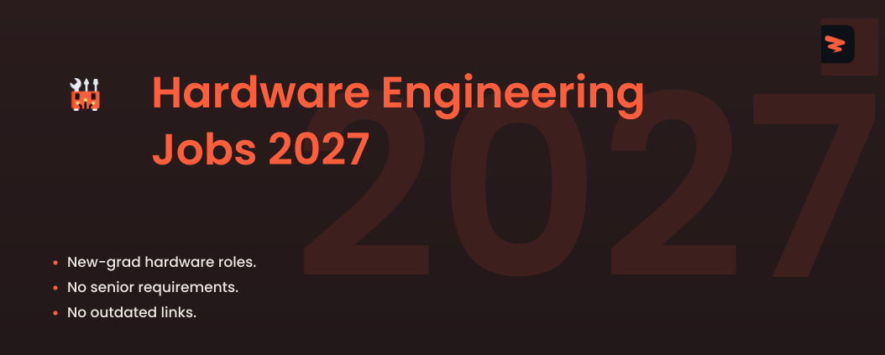

<!-- Cover -->

# Hardware Engineering Jobs 2027

🚀 Hardware, embedded systems, and EE jobs for new graduates, updated every 10 minutes.

  
  
  
  

---

## **Website & Autofill Extension**

Explore Zapply's website and check out:

- Our Chrome extension, which autofills job applications in seconds.
- A dedicated job board featuring the latest openings across various roles.
- User accounts with multiple profiles for different resume types and roles.
- Job application tracking with streaks and commitment awards.

Experience an advanced career journey with us! 🚀

  

## Explore Around

Connect and seek advice from a growing network of fellow students and new grads.

  
  &nbsp;&nbsp;
  

---

 

<h3>⚡ <strong>Hardware Engineer</strong></h3>

| Company | Role | Location | Posted | Visa | **Apply** |
|---------|------|----------|--------|------|----------|
| **Blue Origin** | Mechanical Engineer III | Greater Seattle Area | 13m |  |  |
| **Blue Origin** | Mechanical Engineer II, Quick Disconnect & Valves - New Glenn | Greater Seattle Area | 13m |  |  |
| **Blue Origin** | PCB Design Automation Engineer III | Greater Seattle Area | 13m |  |  |
| **NVIDIA** | Compiler Verification Engineer, Compute Performance – GPU | TX Austin | 14m | ✅ Sponsor |  |
| **NVIDIA** | DSX Electrical Engineer | US, CA, Santa Clara | 14m | ✅ Sponsor |  |
| **NVIDIA** | GPU System and Scheduling Architect – New College Grad 2026 | US, CA, Santa Clara | 14m | ✅ Sponsor |  |
| **HPE (University)** | Hardware Engineering Intern | Westford, Massachusetts, United... | 14m | ✅ Sponsor |  |
| **AeroVironment** | Titan Field Service Engineer Manager - Integration & Training Specialist | Huntsville, AL | 14m |  |  |
| **AeroVironment** | Field Service Representative Intern | Germantown, MD | 14m |  |  |
| **AeroVironment** | Field Service Representative Intern | Germantown, MD | 14m |  |  |
| **Salesforce** | Enterprise Application Engineer (Enterprise Security - Security AI) | California San Francisco | 14m | ✅ Sponsor |  |
| **Cisco** | Hardware Engineer | San Jose, California, US | 14m | ✅ Sponsor |  |
| **Cisco** | Hardware (Signal Integrity) Engineer | RTP, North Carolina, US | 14m | ✅ Sponsor |  |
| **Jabil** | Industrial Engineer I | Maple Grove, MN | 14m | ✅ Sponsor |  |
| **GlobalFoundries** | RF PDK DRC Development Engineer - Design Enablement | Santa Clara | 24m | ✅ Sponsor |  |
| **Bose** | Electrical Engineering Co-op — FPGA and Audio Research Platforms | US, MA - Framingham | 24m | ✅ Sponsor |  |
| **Ambarella** | Physical Design Engineer | Headquarters | 24m | ✅ Sponsor |  |
| **Philips** | Co-op – Mechanical/Process Engineer – Reedsville, PA – January-June 2027 | Reedsville, Pennsylvania,... | 24m | ✅ Sponsor |  |
| **Philips** | Field Service Engineer - Medical Imaging (Field: Philadelphia, PA) | Philadelphia, Pennsylvania,... | 24m | ✅ Sponsor |  |
| **NXP** | Analytical Engineering Technician | Austin | 25m | ✅ Sponsor |  |
| **Marvell** | Hardware Signal Integrity Intern, MS - Summer 2027 | Santa Clara, CA | 25m | ✅ Sponsor |  |
| **Regal Rexnord** | Sales Application Engineer - Data Centers | ,,United States | 25m | ✅ Sponsor |  |
| **Moderna** | 2027 Co-Op, mRNA Design Engineering | Cambridge, Massachusetts,... | 34m |  |  |
| **Draper** | Microfab Wet Etch Engineer | Cambridge, MA | 34m |  |  |
| **Accuray** | Field Service Engineer - St. Louis | Remote - US | 34m |  |  |
| **KION Group** | Controls Engineer (New Graduate/Early Career) | Grand Rapids MI United States | 35m |  |  |
| **Intel** | Physical Design Clocking Engineer | US, California, Santa Clara | 35m | ✅ Sponsor |  |
| **Intel** | Industrial Engineer - Foundry Quality and Reliability Labs | US, Arizona, Phoenix | 35m | ✅ Sponsor |  |
| **Intel** | Module Development Engineer | US, Oregon, Hillsboro | 35m | ✅ Sponsor |  |
| **Micron Technology** | New College Grad: Engineer, Edge Systems Architecture | Boise, ID - Main Site | 35m | ✅ Sponsor |  |
| **Micron Technology** | New College Grad - AMHS Equipment Engineer - ID1 | Boise, ID - ID1 | 35m | ✅ Sponsor |  |
| **Micron Technology** | Process Integration Engineer, APTD | Boise, ID - Main Site | 35m | ✅ Sponsor |  |
| **Nidec** | Controls Engineer | North... | 35m | ✅ Sponsor |  |
| **SpaceX** | Data Center Technician (TS/SCI) | Hawthorne, CA | 39m | ✅ Sponsor |  |
| **Conagra Brands** | Process Engineer (Food Manufacturing) | Rensselaer, Indiana | 44m | ✅ Sponsor |  |
| **Conagra Brands** | Process Engineer | Kent, Washington | 44m | ✅ Sponsor |  |
| **Zebra** | 2027 Summer Internship (US) - Mechanical Engineer, EMC Handheld BU | Holtsville, New York | 44m |  |  |
| **Thornton Tomasetti** | Structural Engineer | New York, NY, USA | 44m |  |  |
| **Baker Hughes** | Applications Engineering - Drill Bits | Jw, ID | 45m | ✅ Sponsor |  |
| **University of Texas at Austin** | Building Automation Systems, Analyst II | AUSTIN, TX | 45m |  |  |
| **Johnson & Johnson** | 2nd Shift - Process Engineer III | Memphis, Tennessee, United... | 45m | ✅ Sponsor |  |
| **SpaceX** | BIM Specialist - Mechanical Systems Modeling (Starbase) | Starbase, TX | 1h | ✅ Sponsor |  |
| **CAE** | C-130/L-382 Instructor Flight Engineer/Maintenance | Tampa | 1h | ✅ Sponsor |  |
| **CAE** | Mechanical Engineer | Arlington, TX | 1h | ✅ Sponsor |  |
| **FOX** | Maintenance Engineer | Milwaukee, Wisconsin, USA | 1h | ✅ Sponsor |  |
| **FOX** | Broadcast Production Engineer | Washington, District of... | 1h | ✅ Sponsor |  |
| **Teledyne** | Process Development Engineer 4 | Huntsville, AL | 1h |  |  |
| **Teledyne** | Component Engineer | El Segundo, CA | 1h |  |  |
| **Cisco** | Hardware Engineer PhD Co-op - United States | San Jose, California, US | 1h | ✅ Sponsor |  |
| **Becton Dickinson** | Reliability Engineer | USA PR - Humacao | 1h | ✅ Sponsor |  |
| **Air Liquide** | Electrical Engineer | Baton Rouge, LA - Sales | 1h |  |  |
| **Onto Innovation** | Mechanical Engineer 3 | Milpitas-CA | 1h | ✅ Sponsor |  |
| **Onto Innovation** | Optical Engineer 3 | Hillsboro-OR | 1h | ✅ Sponsor |  |
| **Onto Innovation** | Applications Scientist 3 | Budd Lake, NJ | 1h | ✅ Sponsor |  |
| **Carrier Global** | Field Engineer - Automated Logic | CAW11: ALC-Brown Deer, 1501... | 1h |  |  |
| **Amentum** | Safety Engineer II | FL-Kennedy Space | 1h |  |  |
| **Amentum** | Safety Engineer IV | FL-Kennedy Space | 1h |  |  |
| **LLNL** | Power Systems Undergraduate Intern - Cyber and Critical Infrastructure Summer Institute - Summer... | Livermore, CA | 1h | ✅ Sponsor |  |
| **LLNL** | Power Systems Graduate Intern - Cyber and Critical Infrastructure Summer Institute - Summer 2027 | Livermore, CA | 1h | ✅ Sponsor |  |
| **Brunswick** | Process Engineer | Fond du Lac, WI | 1h | ✅ Sponsor |  |
| **Brunswick** | Industrial Engineer | Fond du Lac, WI | 1h | ✅ Sponsor |  |
| **Aerospace Corporation** | Space Domain Awareness and Directed Energy Analyst | Colorado Springs, CO | 1h |  |  |
| **Aerospace Corporation** | Tracking Architecture Performance Engineer | El Segundo, CA | 1h |  |  |
| **Aerospace Corporation** | Research and Development Engineer (Microelectronics) | Westfield, VA | 1h |  |  |
| **University of Maryland** | Electronics Technician II – Building Security Services | University of Maryland College Park | 1h |  |  |
| **Caterpillar** | Oil and Gas Project Application Engineering Intern | San Diego, California | 1h | ✅ Sponsor |  |
| **Caterpillar** | Performance/Simulation/Application Engineer | Mossville Illinois | 1h | ✅ Sponsor |  |
| **Caterpillar** | Design Engineering Specialist - Large Advanced Technology Motors and Generators | Mossville Illinois | 1h | ✅ Sponsor |  |
| **ASML** | Optical Surface & Mechanical Inspector CWWBack End Nights, 6:00 PM – 6:00 AM (Wednesday,... | Wilton, CT, USA | 1h | ✅ Sponsor |  |
| **ASML** | Mechatronics Engineer | Wilton, CT, USA | 1h | ✅ Sponsor |  |
| **GE Aerospace** | X-Bat Customer Integration Engineer | Evendale | 1h | ✅ Sponsor |  |
| **AES Corporation** | Mechanical Engineer | US, Petersburg, IN | 1h | ✅ Sponsor |  |
| **Leidos** | Mechanical Engineer | Lynnwood, WA | 1h | ✅ Sponsor |  |
| **Leidos** | Substation Protection and Controls Engineer | Seven Fields, PA | 1h | ✅ Sponsor |  |
| **Trimble** | Civil/Geo Applications Engineer - Rotational Development Program (July 2027) | CO, Westminster | 1h | ✅ Sponsor |  |
| **Menasha Corporation** | Process Engineer | Deforest, Wisconsin | 1h | ✅ Sponsor |  |
| **JM Family Enterprises** | Industrial Engineering Intern | Florida - Jacksonville | 1h |  |  |
| **GDIT** | Electronics Technician III | International | 2h | ✅ Sponsor |  |
| **Merck & Co.** | Technical Operations Engineer (On-site) | USA - New Jersey - Rahway | 2h | ✅ Sponsor |  |
| **Carrier Global** | Building Automation Field Engineer - Data Center | CAW11: ALC-Brown Deer, 1501... | 2h |  |  |
| **KLA** | Customer Engagement Engineer (FaST) | Hillsboro, OR | 2h | ✅ Sponsor |  |
| **KLA** | Applications Development Engineer- eBeam | Milpitas, CA | 2h | ✅ Sponsor |  |
| **KLA** | Customer Engagement Applications Engineer | Chandler, AZ | 2h | ✅ Sponsor |  |
| **Itron** | Industrial Engineer | SC | 2h | ✅ Sponsor |  |
| **Bristol Myers Squibb** | Manufacturing Science and Technology Process Engineering Co-Op | Summit West - NJ - US | 2h | ✅ Sponsor |  |
| **Thermo Fisher Scientific** | Field Service Engineer II - IC & HPLC | Albany, New York, USA | 2h | ✅ Sponsor |  |
| **Thermo Fisher Scientific** | Field Service Engineer | Remote, Michigan, USA | 2h | ✅ Sponsor |  |
| **Crane Co.** | Electrical Engineer III | West Caldwell, New Jersey | 2h | ✅ Sponsor |  |
| **Hitachi** | Mechanical Engineer - I | Greenville, South Carolina,... | 2h | ✅ Sponsor |  |
| **Occidental Petroleum** | GOA Reservoir Engineer | The Woodlands, Texas | 2h | ✅ Sponsor |  |
| **Microsoft** | Physical Design Engineer II | Redmond, Washington, United States | 2h | ✅ Sponsor |  |
| **Northrop Grumman** | Engineer Structural - Level 4 - Devens | United States-Massachusetts-Devens | 2h |  |  |
| **Northrop Grumman** | 2027 Associate Electrical Engineers - Plymouth MN | United States-Minnesota-Plymouth | 2h |  |  |
| **Northrop Grumman** | 2027 Associate Electrical Engineer - San Diego CA | United States-California-San Diego | 2h |  |  |
| **Altera** | Product Development Engineer | San Jose, California, United States | 2h | ✅ Sponsor |  |
| **Altera** | Field Applications Engineer (FAE) | San Jose, California, United States | 2h | ✅ Sponsor |  |
| **ABB** | Mechanical Designer | Fort Smith, Arkansas, United... | 2h | ✅ Sponsor |  |
| **Medtronic** | Field Service Engineer III (Southern Ohio) | State of Ohio, United States of... | 2h | ✅ Sponsor |  |
| **Medtronic** | Reliability Engineer I - Hardware / Electrical | Mounds View, Minnesota, United... | 2h | ✅ Sponsor |  |
| **Medtronic** | Production Coordinator III - Calibration- 1st Shift | Plymouth, Minnesota, United... | 2h | ✅ Sponsor |  |

Apply for more jobs at

<h3>🔲 <strong>FPGA/ASIC</strong></h3>

| Company | Role | Location | Posted | Visa | **Apply** |
|---------|------|----------|--------|------|----------|
| **HP Inc** | Firmware Engineer | Vancouver, Washington, United... | 24m | ✅ Sponsor |  |
| **Micron Technology** | MTS, AI Optimized Memory Digital Design Engineer | Folsom, CA | 35m | ✅ Sponsor |  |
| **Thornton Tomasetti** | Associate Structural Engineer | San Francisco, CA, USA | 44m |  |  |
| **Cisco** | ASIC Power Design Engineer II (Full Time) - United States | San Jose, California, US | 1h | ✅ Sponsor |  |
| **Carrier Global** | Associate Manufacturing Test Engineer (2nd shift) | CAG10: ALC | 1h |  |  |
| **Merck & Co.** | Associate Specialist, Technical Operations Engineer (On-site) | USA - New Jersey - Rahway | 2h | ✅ Sponsor |  |
| **Carrier Global** | Associate Controls Engineer | CAF43: AL Florida (MCO), 7305... | 2h |  |  |
| **Northrop Grumman** | 2027 Associate Electrical RF Engineer - Plymouth MN | United States-Minnesota-Plymouth | 2h |  |  |
| **Moog** | Associate Reliability Engineer | Buffalo, NY | 2h |  |  |
| **Boeing** | Product Review Engineers (Associate and Mid-level) | USA - San Antonio, TX | 2h | ✅ Sponsor |  |
| **Boeing** | Associate Quality Engineer | USA - Huntsville, AL | 2h | ✅ Sponsor |  |
| **Boeing** | Product Review Engineer (Liaison Engineering)  Associate or Experienced | USA - Tukwila, WA | 4h | ✅ Sponsor |  |
| **Google** | TPU Compute RTL Design Engineer | United States | Date unknown | ✅ Sponsor |  |
| **Draper** | Analog ASIC Design Intern (Summer 2027) | Cambridge, MA | 1d |  |  |
| **Micron Technology** | ASIC Analog Layout Engineer | Minneapolis, MN | 1d | ✅ Sponsor |  |
| **Carnegie Mellon University** | Postdoctoral Research Associate - College of Engineering - Mechanical Engineering | Pittsburgh, PA | 1d | ✅ Sponsor |  |
| **Carnegie Mellon University** | Research Associate I - College of Engineering - Biomedical Engineering | Pittsburgh, PA | 1d | ✅ Sponsor |  |
| **Northrop Grumman** | 2026 Associate Thermal Mechanical Engineer  - Dulles | United States-Virginia-Dulles | 1d |  |  |
| **Northrop Grumman** | 2027 Associate Structural Engineer / Structural Engineer - Huntsville AL | United States-Alabama-Huntsville | 1d |  |  |
| **RTX** | FPGA Engineer II | TX-MCKINNEY | 1d | ✅ Sponsor |  |
| **Apple** | Silicon Photonics EPM, Data Center SoC | Cupertino | 1d | ✅ Sponsor |  |
| **Micron** | MTS, AI Optimized Memory Digital Design Engineer | Folsom, California, United... | 1d |  |  |
| **JPMorgan Chase** | Compliance and Operations Risk Test Specialist - Corporate Sector - Associate | OH, United States | 1d | ✅ Sponsor |  |
| **JPMorgan Chase** | Compliance and Operations Risk Test Specialist - Corporate Sector - Associate | San Antonio, TX, United States | 1d | ✅ Sponsor |  |
| **Vertiv** | Associate Engineer, Electrical & Electronics Engineering | Lorain, OH, United States | 1d | ✅ Sponsor |  |
| **Vertiv** | Associate Engineer Electrical & Electronics Engineering VIII | Westerville, OH, United States | 1d | ✅ Sponsor |  |
| **Cummins** | Materials Engineering Associate - OCU - Technical - 3rd Shift | Columbus, IN, United States | 1d | ✅ Sponsor |  |
| **Cisco** | ASIC Power Design Engineer II (Full Time) - United States | San Jose, California | 1d | ✅ Sponsor |  |
| **MITRE** | FPGA / ASIC Design Engineer | Bedford, Massachusetts | 1d |  |  |
| **Amentum** | ASIC Verification Engineer | IN-Crane | 1d |  |  |
| **Applied Materials** | FPGA Engineer III | Rochester,NY | 1d | ✅ Sponsor |  |
| **Apple** | SoC System Level Test Product Development Engineer | Cupertino | 1d | ✅ Sponsor |  |
| **Boston Scientific** | R&D Firmware Engineer Intern | Arden Hills US-MN, United... | 1d |  |  |
| **Micron** | ASIC Analog Layout Engineer | Minneapolis, Minnesota, United... | 2d |  |  |
| **Vertiv** | Associate Mechanical Engineer | Westerville, OH, United States | 2d | ✅ Sponsor |  |
| **Apple** | SoC Power Analysis and Optimization Engineer | Austin | 2d | ✅ Sponsor |  |
| **Cummins** | Mechanical Engineering Associate - OCU - Technical - 1st Shift | Columbus, IN, United States | 2d | ✅ Sponsor |  |
| **Kohl's** | Associate Technical Designer | Menomonee Falls, Wisconsin | 2d |  |  |
| **MITRE** | Associate Embedded Security Engineer | Bedford, Massachusetts | 2d |  |  |
| **Qualcomm** | Calibration Engineer, Associate | San Diego, CA | 3d | ✅ Sponsor |  |
| **Anduril** | FPGA Engineer | Broomfield, Colorado, United States | 3d |  |  |
| **NVIDIA** | ASIC Verification Engineer - New College Grad 2027 | US, CA, Santa Clara | 4d | ✅ Sponsor |  |
| **NVIDIA** | Low Power ASIC Engineer - New College Grad 2027 | US, CA, Santa Clara | 4d | ✅ Sponsor |  |
| **NVIDIA** | ASIC Clocks Verification Engineer - New College Grad 2026 | US, CA, Santa Clara | 4d | ✅ Sponsor |  |
| **BlackRock** | Associate, Application Engineer III | San Francisco, CA | 4d | ✅ Sponsor |  |
| **BlackRock** | Associate, Application Engineer III | San Francisco, CA | 4d | ✅ Sponsor |  |
| **Micron Technology** | HBM SoC RTL Design Engineer | Folsom, CA | 4d | ✅ Sponsor |  |
| **Sierra Nevada Corporation** | Firmware Engineering Intern | Folsom, CA | 4d |  |  |
| **Cisco** | ASIC Failure Analysis Engineer (Onsite) | San Jose, California, US | 4d | ✅ Sponsor |  |
| **Motorola Solutions** | Business Development Engineer (BDE), USSOCOM | California Southern Remote... | 4d | ✅ Sponsor |  |
| **Carnegie Mellon University** | Postdoctoral Research Associate - College of Engineering - Mechanical Engineering | Pittsburgh, PA | 4d | ✅ Sponsor |  |
| **Merck & Co.** | Associate Specialist, Process Engineer - Oral Solid Dosage, Clinical Manufacturing (Onsite) | USA - New Jersey - Rahway | 4d | ✅ Sponsor |  |
| **Carrier Global** | Associate Field Engineer - Automated Logic (Waco, TX) | CAT16: CCS-Dallas, 1901 N.... | 4d |  |  |
| **ABB** | Associate Mechanical Design Engineer | USA, NC, Mebane | 4d | ✅ Sponsor |  |
| **Moog** | Associate Electrical Design Engineer | Buffalo, NY | 4d |  |  |
| **Broadcom** | IC Design Engineer (STA/ Synthesis) | CA San Jose Innovation Drive | 4d | ✅ Sponsor |  |
| **Broadcom** | ASIC Design Engineer | USA-Colorado-Fort Collins | 4d | ✅ Sponsor |  |
| **Broadcom** | ASIC Design Automation Engineer | USA-Colorado-Fort Collins | 4d | ✅ Sponsor |  |
| **Samsara** | Firmware Engineer | San Francisco, CA, United States | 4d | ✅ Sponsor |  |
| **Abbott** | Associate Quality Engineer | United States - Texas - Irving | 4d | ✅ Sponsor |  |
| **HPE (University)** | ASIC Verification Engineering Intern | Roseville, California, United... | 5d | ✅ Sponsor |  |
| **AeroVironment** | Associate Electrical Designer - HyperRF Systems | Germantown, MD | 5d |  |  |
| **HP Inc** | Firmware Engineer | Vancouver, Washington, United... | 5d | ✅ Sponsor |  |
| **AstraZeneca** | Associate Process Engineer, Cell Therapy Process Development | – Santa Monica Colorado Avenue – CA | 5d | ✅ Sponsor |  |
| **Microsoft** | Firmware Engineer (SCHIE) | Redmond, Washington, United States | 5d | ✅ Sponsor |  |
| **Caterpillar** | Associate Design Engineer | Rapid City, South Dakota | 5d | ✅ Sponsor |  |
| **Merck & Co.** | Associate Specialist, Technical Operations Engineering | USA - Pennsylvania - West Point | 5d | ✅ Sponsor |  |
| **Analog Devices** | Associate Field Applications Engineer (Sales Rotational Program) | US, CA, San Diego, Avenue of... | 5d | ✅ Sponsor |  |
| **Analog Devices** | Associate Central Applications Engineer | US, MA, Wilmington | 5d | ✅ Sponsor |  |
| **Analog Devices** | Associate Test Engineer | US, CA, San Jose, Rio Robles | 5d | ✅ Sponsor |  |
| **Avnet** | Associate Field Application Engineer - AMD | Wilmington, Massachusetts,... | 5d | ✅ Sponsor |  |
| **Avnet** | Associate Field Application Engineer - AMD | San Jose, California, United... | 5d | ✅ Sponsor |  |
| **Rolls-Royce** | Digital Design and MBD/MBE Engineer | Indianapolis | 5d |  |  |
| **Leidos** | Associate Substation Engineer | Chicago, IL | 5d | ✅ Sponsor |  |
| **Micron** | HBM SoC RTL Design Engineer | Folsom, California, United... | 5d |  |  |
| **Kohl's** | Associate Reliability Engineer (Remote) | Menomonee Falls, Wisconsin | 5d |  |  |
| **MITRE** | Associate Mechanical Engineer | Bedford, Massachusetts | 5d |  |  |
| **AMD** | Solutions Architect-FPGA | San Jose, CA, United States | 5d | ✅ Sponsor |  |
| **Eversource Energy** | Associate Civil Engineer, Transmission Line Engineering (Hybrid Schedule) | Hartford, CT | 6d | ✅ Sponsor |  |
| **Leonardo** | Associate Flight Test Engineer, Production | Philadelphia | 6d |  |  |
| **Trane Technologies** | Associate Engineer | La Crosse, Wisconsin | 6d | ✅ Sponsor |  |
| **Abbott** | Associate Quality Engineer (second shift 3:30pm to 2:00am) | United States - Massachusetts -... | 6d | ✅ Sponsor |  |
| **Bosch Group** | Associate/Envir. Health & Safety Engineer | Roseville, CA | 6d | ✅ Sponsor |  |
| **Fluor** | Associate Design Engineer I - Civil New Graduate | Houston, US-TX, United States | 6d |  |  |
| **Fluor** | Associate Design Engineer I - Structural New Graduate | Houston, US-TX, United States | 6d |  |  |
| **LLNL** | Engineering Technical Associate | Livermore, CA | 6d | ✅ Sponsor |  |
| **Abbott** | Associate Quality Engineer | United States - Wisconsin - Madison | 1w | ✅ Sponsor |  |
| **Astera Labs** | Synthesis & STA Engineer – High-Speed SerDes | San Jose, California, United States | 1w | ✅ Sponsor |  |
| **AMD** | RTL Design Engineer | Austin, TX, United States | 1w | ✅ Sponsor |  |
| **Veolia Environnement SA** | Associate EI&C Engineer | Glen Allen, VA | 1w | ✅ Sponsor |  |
| **Veolia Environnement SA** | Associate EI&C Engineer | Minnetonka, MN | 1w | ✅ Sponsor |  |
| **Veolia Environnement SA** | Associate EI&C Engineer | Bellevue, WA | 1w | ✅ Sponsor |  |
| **Intel** | Memory Firmware Engineer | Oregon Hillsboro | 1w | ✅ Sponsor |  |
| **Intel** | RTL Design Engineer | Texas Austin | 1w | ✅ Sponsor |  |
| **Google** | ASIC Power Engineer, ML Accelerators | United States | Date unknown | ✅ Sponsor |  |
| **RTX** | FPGA Design Engineer II | AZ-TUCSON-M02 | 1w | ✅ Sponsor |  |
| **RTX** | Digital Design Engineer II | AZ-TUCSON-M02 | 1w | ✅ Sponsor |  |
| **KLA** | Associate Test Engineer (Opto-Mech) | Milpitas, CA | 1w | ✅ Sponsor |  |
| **Qualcomm** | SOC Design Verification Engineer | San Diego, CA | 1w | ✅ Sponsor |  |
| **Qualcomm** | Next-Gen, High-Speed HBM, LPDDR Memory Subsystem ASIC Digital Design Engineer | San Diego, CA | 1w | ✅ Sponsor |  |

Apply for more jobs at

<h3>🔌 <strong>Embedded Systems</strong></h3>

| Company | Role | Location | Posted | Visa | **Apply** |
|---------|------|----------|--------|------|----------|
| **HP Inc** | C++ Engineer (Computer Vision/Embedded Systems) | Austin, Texas, United States of... | 24m | ✅ Sponsor |  |
| **Broadcom** | R&D Engineer Firmware | USA-CA Irvine Alton Parkway Bldg 2 | 3h | ✅ Sponsor |  |
| **NVIDIA** | Field Applications Engineer, Embedded Systems - NALA | US, CA, Santa Clara | 1d | ✅ Sponsor |  |
| **Shield AI** | Summer 2027 Intern - Embedded Firmware - 5810 | Dallas, Texas | 1d | ✅ Sponsor |  |
| **NVIDIA** | Senior Solutions Architect, Embedded Physical AI | CA Santa Clara | 4d | ✅ Sponsor |  |
| **Motorola Solutions** | Embedded Software Engineer | Los Angeles, CA | 4d | ✅ Sponsor |  |
| **Motorola Solutions** | Embedded Software Engineer | Allen, TX | 4d | ✅ Sponsor |  |
| **Northrop Grumman** | Consulting Embedded Software Engineer | United States-Maryland-Baltimore | 4d |  |  |
| **Northrop Grumman** | Consulting Embedded Software Engineer | United States-Maryland-Baltimore | 4d |  |  |
| **Analog Devices** | Embedded AI Tools Engineer | US, MA, Wilmington | 4d | ✅ Sponsor |  |
| **Apple** | Embedded Signal Processing and ML Algorithms Engineer | San Diego | 4d | ✅ Sponsor |  |
| **Northrop Grumman** | Embedded Software Engineer – Level 3 or 4 | United States-Virginia-Dulles | 5d |  |  |
| **Baker Hughes** | Embedded Software Engineer | NV-MINDEN | 5d | ✅ Sponsor |  |
| **HP Inc** | Firmware Security Certification Engineer | Vancouver, Washington, United... | 6d | ✅ Sponsor |  |
| **MITRE** | Intermediate Embedded Security Engineer | Bedford, Massachusetts | 6d |  |  |
| **GE Aerospace** | Embedded Product Cybersecurity Engineer – Embedded Software | Evendale | 1w | ✅ Sponsor |  |
| **Leidos** | Embedded Design Engineer | Huntsville, AL | 1w | ✅ Sponsor |  |
| **Philips** | Co-op -Embedded Test Engineer - Murrysville, PA-January-June 2027 | Murrysville, Pennsylvania,... | 1w | ✅ Sponsor |  |
| **Western Digital** | Manager, Firmware Development | Rochester, MN | 1w | ✅ Sponsor |  |
| **Apple** | Embedded QA Engineer - Camera,  ISP FW & Driver | Cupertino | 1w | ✅ Sponsor |  |
| **Apple** | Camera Embedded Software Engineer | Cupertino | 1w | ✅ Sponsor |  |
| **JLL** | BMS Controls Engineer /IoT Operations SME | Atlanta, GA | 1w | ✅ Sponsor |  |
| **Analog Devices** | Embedded Systems Co-Op | US, MA, Boston | 1w | ✅ Sponsor |  |
| **Xcimer Energy** | Embedded Engineer | Denver, CO | 1w |  |  |
| **Eaton** | Early Career Internship Program: Engineering Technology - Embedded Systems | Moon Township, Pennsylvania,... | 1w |  |  |
| **Parsons** | Embedded Systems Reverse Engineer - Secret | AL, Huntsville, R186208 | Date unknown |  |  |
| **Parsons** | Firmware-Savvy CNO Developer (TS/SCI w/Poly) | MD, Annapolis Junction, R180581 | Date unknown |  |  |
| **Parsons** | Embedded Systems Reverse Engineer - Secret | AL, Huntsville, R186205 | Date unknown |  |  |
| **Aalyria** | Embedded Real-Time Controls Engineer, Free-Space Optical Communications | Livermore, CA | Date unknown |  |  |
| **Boom Supersonic** | Electrical or Embedded Controls Engineer (Early Career, Exceptional Talent) | Centennial, CO | Date unknown |  |  |
| **Thermo Fisher Scientific** | Embedded Controls Engineer | Marietta, Ohio, USA | 1w | ✅ Sponsor |  |
| **Blue Origin** | Embedded Software Engineer Levels II and III | Greater Seattle Area | 1w |  |  |
| **Verkada** | Firmware Release & Test Automation Engineer | San Mateo, CA United States | 1w | ✅ Sponsor |  |
| **GE Aerospace** | Real-Time Embedded Software & Verification Engineer | Grand Rapids | 1w | ✅ Sponsor |  |
| **Aptiv** | RTOS Development Engineer | USA Walnut Creek, CA - WR | 1w | ✅ Sponsor |  |
| **Blue Origin** | Embedded Software Engineer III | Greater Seattle Area | 1w |  |  |
| **NXP** | Field Application Engineer - Microcontrollers | USA | 1w | ✅ Sponsor |  |
| **Eaton** | Embedded Firmware Specialist | Raleigh, North Carolina, USA, 27616 | 1w |  |  |
| **Rockwell Automation** | Intern - Embedded Controls Engineering | Orlando, Florida, United States | 2w | ✅ Sponsor |  |
| **Micron Technology** | Intern - SSD Firmware | San Jose, CA | 2w | ✅ Sponsor |  |
| **Micron Technology** | Intern - SSD Firmware | Boise ID Main Site | 2w | ✅ Sponsor |  |
| **Micron** | Intern - SSD Firmware | Boise, Idaho, United States of... | 2w |  |  |
| **Micron** | Intern - SSD Firmware | San Jose, California, United... | 2w |  |  |
| **Bose** | Embedded Audio ML Engineer Co-op | US, MA - Framingham | 3w | ✅ Sponsor |  |
| **SharkNinja** | Manager, Embedded Firmware Architecture | Needham, MA, United States | 3w | ✅ Sponsor |  |
| **Micron Technology** | Intern - SSD Firmware - CICD | Longmont-MAX- | 3w | ✅ Sponsor |  |
| **Micron** | Intern - SSD Firmware - CICD | Longmont, Colorado, United... | 3w |  |  |
| **Amazon.com Services LLC - A57** | Embedded Firmware Co-op, Amazon Robotics - Spring 2027 | North Reading, MA | 3w | ✅ Sponsor |  |
| **iRhythm** | Embedded SDET Co-Op Full Time Intern January-June 2027 | San Francisco, CA | 1mo |  |  |
| **Stanley Black & Decker** | Embedded Engineering Summer Intern 2027 | Towson, MD, United States | 1mo | ✅ Sponsor |  |
| **Penn State University** | Embedded Systems and Hardware Co-Op | Warminster, PA | 1mo |  |  |
| **Axon** | Firmware Validation Engineer I (Onsite) | Scottsdale, Arizona, United States | 1mo |  |  |
| **Qualcomm** | Embedded Engineering Internship - Summer 2027 | San Diego, CA | 1mo | ✅ Sponsor |  |
| **AMD** | Embedded Firmware Development Engineer | Austin, TX, United States | 1mo | ✅ Sponsor |  |
| **Flagship Pioneering** | Pioneering Intelligence: Data Science Co-Op (Embedded Science Team) | Cambridge, MA USA | 1mo |  |  |
| **SpaceX** | GNC Engineer - Embedded Controls (Starlink) | Redmond, WA | 2026-09-04 | ✅ Sponsor |  |
| **Honeywell** | Embedded Engineer - Summer 2027 Intern (US Person Required) | United States | 2026-08-25 | ✅ Sponsor |  |
| **Honeywell** | Embedded Engineer - Summer 2027 Intern | United States | 2026-08-25 | ✅ Sponsor |  |
| **SpaceX** | Embedded Security Engineer (Starlink) | Bastrop, TX | 2026-08-18 | ✅ Sponsor |  |
| **SpaceX** | Embedded Security Engineer (Starlink) | Hawthorne, CA | 2026-08-18 | ✅ Sponsor |  |
| **ALTEN Technology** | Embedded Linux Security Engineer | Foster City, California, United... | 2026-08-12 |  |  |
| **Coinbase** | Embedded Engineer, Compliance \[Office of the CTO\] | Remote - USA | 2026-07-31 | ✅ Sponsor |  |
| **Second Order Effects** | Embedded Engineer | Redmond, United States | 2026-07-13 |  |  |
| **Second Order Effects** | Embedded Engineer | El Segundo, United States | 2026-07-13 |  |  |
| **Redwood Materials** | Embedded Software Engineer – Power Electronics, Energy Storage | San Francisco, California,... | 2026-07-09 | ✅ Sponsor |  |
| **DoorDash** | Firmware Validation & Integration Engineer | San Francisco, CA | 2026-06-17 | ✅ Sponsor |  |
| **AMD** | Hardware Systems Design Engineer – x86 Embedded Solutions | San Jose, CA, United States | 2026-05-28 | ✅ Sponsor |  |
| **Anduril** | Embedded NixOS Engineer | Costa Mesa, California, United... | 2026-02-05 |  |  |
| **Kodiak Robotics** | Software Engineer, Embedded | Mountain View, CA | 2025-06-16 | ✅ Sponsor |  |

Apply for more jobs at

<h3>🔋 <strong>Electrical Engineer</strong></h3>

| Company | Role | Location | Posted | Visa | **Apply** |
|---------|------|----------|--------|------|----------|
| **Blue Origin** | Fluids Test Engineer III - Lunar Permanence | Space Coast, FL | 13m |  |  |
| **Blue Origin** | Test Engineer II   Launch Ops (Mechanical/Fluids) | Space Coast, FL | 13m |  |  |
| **Blue Origin** | Launch and Test Engineer III (Avionics) | Space Coast, FL | 13m |  |  |
| **NVIDIA** | PCIe Post-Silicon Validation Engineer - New College Grad 2027 | US, CA, Santa Clara | 14m | ✅ Sponsor |  |
| **AeroVironment** | System Test Engineer III | Moorpark, CA | 14m |  |  |
| **AeroVironment** | Systems Test Engineer II | Moorpark, CA | 14m |  |  |
| **AeroVironment** | RF PCBA Design and Test Engineer | Albuquerque, NM | 14m |  |  |
| **Jabil** | Test Engineering Technician II | Florence, KY | 14m | ✅ Sponsor |  |
| **DoorDash** | Manufacturing Test Engineer - Dot | Oakland, CA | 49m | ✅ Sponsor |  |
| **Teledyne** | Systems Test Engineer - Electrical (US Citizenship Required) | Billerica, MA | 1h |  |  |
| **Caterpillar** | Test & Validation Engineer - Drivetrain | Mossville, Illinois | 1h | ✅ Sponsor |  |
| **Itron** | Test Engineer | SC | 2h | ✅ Sponsor |  |
| **RTX** | Test Engineering Specialist Co-Op (Onsite) | MA-ANDOVER-AN1 | 3h | ✅ Sponsor |  |
| **CACI** | Test Engineer | Remote | 5h | ✅ Sponsor |  |
| **Anduril** | Flight Test Engineer | Costa Mesa, California, United... | 5h |  |  |
| **Northwood Space** | Development Test Engineer (Prism) | Torrance, CA | 5h |  |  |
| **Amentum** | Test Engineer - NISSC 3 - COS | CO-Colorado Springs | 5h |  |  |
| **Amentum** | Test Engineer | VA-Dahlgren | 5h |  |  |
| **Booz Allen Hamilton** | Automation Test Engineer | Chantilly, VA | 6h | ✅ Sponsor |  |
| **Jabil** | Test Engineer IV | Memphis, TN | 7h | ✅ Sponsor |  |
| **Jabil** | Test Engineer - Liquid Cooling | Florence, KY | 7h | ✅ Sponsor |  |
| **SharkNinja** | Test Engineer | Needham, MA, United States | 8h | ✅ Sponsor |  |
| **INFICON** | Automation & Test Engineer | East Syracuse, NY | 8h | ✅ Sponsor |  |
| **Zone 5 Technologies** | Flight Test Engineer V/VI | San Luis Obispo, California,... | 8h |  |  |
| **AMD** | High Speed IO (HSIO) Validation Engineer | Santa Clara, CA, United States | 8h | ✅ Sponsor |  |
| **Redwood Materials** | Software Validation Engineer, Energy Storage | San Francisco, California,... | 9h | ✅ Sponsor |  |
| **Apple** | PMU Analog Layout Designer | Austin | 9h | ✅ Sponsor |  |
| **Apple** | PMU Silicon Validation Engineer | Cupertino | 9h | ✅ Sponsor |  |
| **Zone 5 Technologies** | Flight Test Engineer III/IV | San Luis Obispo, California,... | 9h |  |  |
| **Anduril** | Flight Test Engineer - MA | Costa Mesa, California, United... | 12h |  |  |
| **Anduril** | RF Manufacturing Test Engineer | Fort Collins, Colorado, United... | 12h |  |  |
| **Booz Allen Hamilton** | Test Engineer | Aurora, CO | 12h | ✅ Sponsor |  |
| **Parsons** | External Test Engineer | CO, Schriever Space Force Base,... | Date unknown |  |  |
| **SharkNinja** | Spring 2027: Electrical Design Engineering Co-op, Advanced Development (January to June) | Needham, MA, United States | 13h | ✅ Sponsor |  |
| **Dev Technology** | Test Engineer | Reston, VA | 15h |  |  |
| **HPE (University)** | Manufacturing Product Test Engineer | Sunnyvale, California, United... | 1d | ✅ Sponsor |  |
| **Draper** | Integration and Test Engineer | Cambridge, MA | 1d |  |  |
| **Draper** | Integration and Test Engineer | Cambridge, MA | 1d |  |  |
| **Caterpillar** | Electrical Design Engineer - Electric Power | Griffin, Georgia | 1d | ✅ Sponsor |  |
| **ASML** | System Integration and Test Engineer | San Diego, CA, USA | 1d | ✅ Sponsor |  |
| **HPE** | Manufacturing Product Test Engineer | Sunnyvale, California, United... | 1d | ✅ Sponsor |  |
| **RTX** | Product Test Engineer II (2nd Shift) | AZ-TUCSON | 1d | ✅ Sponsor |  |
| **Broadcom** | Test Engineer (ATE) | USA-CA San Jose Innovation Drive | 1d | ✅ Sponsor |  |
| **CACI** | Section 508 Compliance Test Engineer | Any State | 1d | ✅ Sponsor |  |
| **Leidos** | TPS Systems Test Engineer | Washington, DC | 1d | ✅ Sponsor |  |
| **Boeing** | Entry Level Electrical Design Engineer | USA - Hazelwood, MO | 1d | ✅ Sponsor |  |
| **ALTEN Technology** | Test Engineer Power Electronics Traction Inverters | Newark, California, United States | 1d |  |  |
| **Apple** | Analog/Mixed Signal IP Engineering Program Manager | Austin | 1d | ✅ Sponsor |  |
| **ALTEN Technology** | Vehicle Safety Test Engineer | Newark, California, United States | 1d |  |  |
| **CACI** | Data Test Engineer | Any State | 1d | ✅ Sponsor |  |
| **Texas Instruments** | Test Engineer - HVDC | Dallas, TX, United States | 1d | ✅ Sponsor |  |
| **Qualcomm** | Modem System Test Engineer – 6G/5G Air Interface | San Diego, CA | 1d | ✅ Sponsor |  |
| **Pivotal Software** | Battery Test Engineer - Aeromechanical | Palo Alto, CA | 1d |  |  |
| **GDIT** | Test Engineer - TS/SCI with Polygraph | USA MD Bethesda | 1d | ✅ Sponsor |  |
| **GDIT** | Test Engineer 2 | USA MD Annapolis Junction | 1d | ✅ Sponsor |  |
| **GDIT** | Test Engineer 3 | USA MD Annapolis Junction | 1d | ✅ Sponsor |  |
| **IEM** | Electrical Design Engineer II | Jacksonville, Florida, United... | 1d |  |  |
| **Eaton** | Power Electronics Engineering Intern | Menomonee Falls, Wisconsin,... | 1d |  |  |
| **HPE (University)** | Systems Test Engineer II | Spring, Texas, United States of... | 2d | ✅ Sponsor |  |
| **HPE** | Systems Test Engineer II | Spring, Texas, United States of... | 2d | ✅ Sponsor |  |
| **Analog Devices** | Analog Design Engineer | US, TX, Dallas, Tollway | 3d | ✅ Sponsor |  |
| **NVIDIA** | SRAM Circuit Design Engineer - New College Grad 2026 | US, CA, Santa Clara | 4d | ✅ Sponsor |  |
| **NVIDIA** | High Speed SerDes Validation Engineer - New College Grad 2026 | US, CA, Santa Clara | 4d | ✅ Sponsor |  |
| **Varda Space** | Space Avionics Test Engineer II | El Segundo, California, United... | 4d |  |  |
| **General Motors** | 2027 Summer Intern – Research and Development - Power Electronics & Energy Conversion Systems | 2 Locations | 4d | ✅ Sponsor |  |
| **Cadence** | Product Engineer (Analog Circuit Design) | SAN JOSE | 4d |  |  |
| **GE Vernova** | Electrical Design Engineer ,- Turbogenerators | Schenectady | 4d | ✅ Sponsor |  |
| **Leidos** | Mechanical Test Engineer | Huntsville, AL | 4d | ✅ Sponsor |  |
| **Leidos** | Junior Mechanical Test Engineer | Huntsville, AL | 4d | ✅ Sponsor |  |
| **Baxter International** | Quality Validation Engineer - Onsite Weekdays | Medina, New York | 4d |  |  |
| **ALTEN Technology** | Glazing & Closures Validation Engineer | Foster City, California, United... | 4d |  |  |
| **Base Power** | Manufacturing Test Engineering Intern | Austin, TX | 4d | ✅ Sponsor |  |
| **CFS Energy** | Intern - R&D Test Engineer - Spring or Summer 2027 | Devens, MA & Somerville, MA | 4d |  |  |
| **Booz Allen Hamilton** | Test Engineer | Warren, MI | 4d | ✅ Sponsor |  |
| **Draper** | Electrical Integration and Test Engineer | Cambridge, MA | 5d |  |  |
| **Intel** | Analog Circuit Designer (Contract) | US, California, Folsom | 5d | ✅ Sponsor |  |
| **Cisco** | Silicon Validation Engineer | San Jose, California, US | 5d | ✅ Sponsor |  |
| **Aerospace Corporation** | Microwave Test Engineer | El Segundo, CA | 5d |  |  |
| **Polaris** | Validation Engineer | Wyoming, MN, USA | 5d |  |  |
| **RTX** | Naval Power Engineering Business Analyst Manager | AZ-TUCSON | 5d | ✅ Sponsor |  |
| **Zipline** | Manufacturing Test Engineer | South San Francisco,... | 5d | ✅ Sponsor |  |
| **Boeing** | Experienced Electrical and Test Engineer | USA - Huntsville, AL | 5d | ✅ Sponsor |  |
| **Texas Instruments** | Test Engineer   Motor Drives | Dallas, TX, United States | 5d | ✅ Sponsor |  |
| **Nokia** | Technical Support and Validation Engineer | United States | 5d | ✅ Sponsor |  |
| **Amentum** | Electrical Design Engineer - Analog/Digital | AL-Huntsville | 5d |  |  |
| **Northwood Space** | Development Test Engineer (Portal) | Torrance, CA | 5d |  |  |
| **Eaton** | Test Engineer | South Milwaukee, Wisconsin,... | 5d |  |  |
| **AMD** | Data Center GPU Board Power Validation Engineer | Austin, TX, United States | 5d | ✅ Sponsor |  |
| **Northwood Space** | Power Electronics Engineer (Prism) | Torrance, CA | 5d |  |  |
| **Northrop Grumman** | Systems Test Engineer 4 | United States-California-Sunnyvale | 5d |  |  |
| **Accenture Federal Services** | Automation Test Engineer | Washington, DC | 5d |  |  |
| **GE Aerospace** | Test Engineer | Evendale | 5d | ✅ Sponsor |  |
| **Aevex Aerospace** | Flight Test Engineer | Poway, California, United States | 5d |  |  |
| **NXP** | SRAM/ROM Circuit Design Engineer | Austin | 6d | ✅ Sponsor |  |
| **JLL** | Sprinkler Weekly Test Engineer | Birmingham, GBR | 6d | ✅ Sponsor |  |
| **Northrop Grumman** | Analog Design Engineer | United... | 6d |  |  |
| **Northrop Grumman** | Systems Test Engineer (Level 2 or 3) | United States-Minnesota-Plymouth | 6d |  |  |
| **Daimler Truck** | Mechanical Product Validation Engineering Intern | Portland, OR US | 6d | ✅ Sponsor |  |
| **Broadcom** | Board Validation Engineer | USA-GA-Duluth-River Green Parkway | 6d | ✅ Sponsor |  |
| **Dell Technologies** | Test Engineer 1 (3rd Shift) | Franklin, MA, United States | 6d |  |  |

Apply for more jobs at

<h3>✅ <strong>Validation Engineer</strong></h3>

| Company | Role | Location | Posted | Visa | **Apply** |
|---------|------|----------|--------|------|----------|
| **Blue Origin** | Quality Engineer II | Greater Seattle Area | 13m |  |  |
| **Blue Origin** | Quality Engineer (B-Shift) | Greater Seattle Area | 13m |  |  |
| **Symbotic** | New Grad- Quality Engineer | USA Wilmington, MA - ITC | 14m | ✅ Sponsor |  |
| **Medtronic** | Quality Engineer  II | North Haven, Connecticut,... | 25m | ✅ Sponsor |  |
| **Baxter International** | Quality Engineer I | Cleveland, Mississippi | 25m |  |  |
| **Brunswick** | Supplier Quality Engineer | Edgewater, FL | 1h | ✅ Sponsor |  |
| **Caterpillar** | Quality Engineer | Lafayette, Indiana | 1h | ✅ Sponsor |  |
| **GE Aerospace** | Supplier Quality Engineer | Springdale | 1h | ✅ Sponsor |  |
| **GE Aerospace** | Asheville Rotating Parts Quality Engineer | Asheville | 1h | ✅ Sponsor |  |
| **GE Aerospace** | TDC Shop Quality Engineer | Evendale | 1h | ✅ Sponsor |  |
| **Northrop Grumman** | Quality Engineer Level 2 and 3 | United States-Utah-Clearfield | 2h |  |  |
| **Medtronic** | Quality Engineer I  (CAS), Rice Creek, MN | Minneapolis, Minnesota, United... | 2h | ✅ Sponsor |  |
| **Medtronic** | Operations Quality Engineer II | North Haven, Connecticut,... | 2h | ✅ Sponsor |  |
| **Boeing** | Quality Engineer (Build Reliability Engineer) 2nd Shift - Millennium Space Systems | USA - El Segundo, CA | 2h | ✅ Sponsor |  |
| **RTX** | Program Supplier Quality Engineer - 50% travel | AL-REMOTE | 3h | ✅ Sponsor |  |
| **RTX** | EMI / EMC / Power Quality Engineer | CA-EL SEGUNDO-E02 | 3h | ✅ Sponsor |  |
| **RTX** | EMI / EMC / Power Quality Engineer | TX-MCKINNEY | 3h | ✅ Sponsor |  |
| **Envista Holdings** | Quality Engineer | WI | 3h |  |  |
| **Leidos** | Quality Engineer | Huntsville, AL | 3h | ✅ Sponsor |  |
| **Eaton** | Supplier Quality Engineer | Davenport, Iowa, USA, 52804 | 8h |  |  |
| **Trane Technologies** | Quality Engineer | Carrollton TX 1628 West Crosby Road | 8h | ✅ Sponsor |  |
| **Astera Labs** | Rackscale Product Quality Engineer | San Jose, California, United States | 10h | ✅ Sponsor |  |
| **American Rare Earths** | Quality Engineer | Stillwater, OK | Date unknown |  |  |
| **Boston Scientific** | Quality Engineer I | Arden Hills US-MN, United... | 13h |  |  |
| **Eaton** | Supplier Quality Engineer | Waukesha, Wisconsin, USA, 53188 | 14h |  |  |
| **John Deere** | Part-Time Student - Quality Engineer - Thibodaux, LA | Thibodaux,Louisiana,United States | 16h |  |  |
| **Blue Origin** | Quality Engineer III – Design Quality & R&D Integration | Greater Seattle Area | 1d |  |  |
| **NVIDIA** | Post-Silicon Validation and Methodology Engineer | US, CA, Santa Clara | 1d | ✅ Sponsor |  |
| **Johnson & Johnson** | Design Quality Engineer II | Warsaw, Indiana, United States... | 1d | ✅ Sponsor |  |
| **Cisco** | Semiconductor Packaging Component Quality Engineer | San Jose, California, US | 1d | ✅ Sponsor |  |
| **Crane Co.** | Quality Engineer II/III | Lynnwood, Washington | 1d | ✅ Sponsor |  |
| **Northrop Grumman** | Quality Engineer | United States-Maryland-Elkridge | 1d |  |  |
| **Cisco** | Semiconductor Packaging Component Quality Engineer | San Jose, California | 1d | ✅ Sponsor |  |
| **Relativity Space** | Quality Engineer II | Stennis Space | 1d | ✅ Sponsor |  |
| **Jabil** | Quality Engineer II - JDAS | St. Petersburg/Tampa, FL | 1d | ✅ Sponsor |  |
| **Fresenius Medical Care** | Supplier Quality Engineer I | Knoxville, TN, USA | 1d | ✅ Sponsor |  |
| **Eaton** | Quality Engineer | Orchard Park, New York, USA, 14127 | 1d |  |  |
| **Saronic Technologies** | NPI Quality Engineer - Naval | Austin, TX | 1d |  |  |
| **Honeywell** | Quality Engineer II | Acton, MA, United States | 2d | ✅ Sponsor |  |
| **GE Vernova** | Process Quality Engineer | Houston | 3d | ✅ Sponsor |  |
| **Micron Technology** | DRAM and Emerging Memory Quality Engineer | Boise, ID - Main Site | 4d | ✅ Sponsor |  |
| **Nidec** | Design Quality Engineer (ASPICE) | North America/USA/Illinois/St.... | 4d | ✅ Sponsor |  |
| **NVIDIA** | Supplier Quality Engineer | US, CA, Santa Clara | 4d | ✅ Sponsor |  |
| **Sierra Nevada Corporation** | Program Quality Engineer III | Dayton, OH | 4d |  |  |
| **Sierra Nevada Corporation** | Quality Engineer Intern (Summer 2027) | Dayton, OH | 4d |  |  |
| **Allegion** | Manufacturing Quality Engineer | Greenfield, IN - West 350N | 4d |  |  |
| **Caterpillar** | Supplier Quality Engineer - Aftertreatment | Pontiac, Illinois | 4d | ✅ Sponsor |  |
| **Rolls-Royce** | Quality Engineer | Mankato | 4d |  |  |
| **Rolls-Royce** | Quality Engineer - NPI | Mankato | 4d |  |  |
| **OpenAI** | Manufacturing Quality Engineer, Data Center Equipment | Remote | 4d | ✅ Sponsor |  |
| **Applied Materials** | Metrology Ops and Customer Quality Engineer lll - (E3) | Austin,TX | 4d | ✅ Sponsor |  |
| **AMD** | Switch Quality Engineer | Santa Clara, CA, United States | 4d | ✅ Sponsor |  |
| **Bosch Group** | Quality Engineering Intern / Co-op - Spring 2027 | Florence, KY | 4d | ✅ Sponsor |  |
| **General Motors** | Supplier Quality Engineer - GM Defense | Warren, Michigan, United States... | 5d | ✅ Sponsor |  |
| **Generac** | Quality Engineer III | Belvidere, IL - USA | 5d | ✅ Sponsor |  |
| **Micron Technology** | Product Quality Engineer | Longmont-MAX- | 5d | ✅ Sponsor |  |
| **Micron Technology** | Product Quality Engineer | Longmont-MAX- | 5d | ✅ Sponsor |  |
| **Novanta** | Quality Engineer | Irvine, CA | 5d | ✅ Sponsor |  |
| **Globus Medical** | Quality Engineer | Pennsylvania - Limerick | 5d | ✅ Sponsor |  |
| **ABB** | Customer Quality Engineering Specialist | USA, MS, Senatobia | 5d | ✅ Sponsor |  |
| **Boeing** | Mid-Level Supplier Quality Engineer - Technical Integration | USA - St. Louis City, MO | 5d | ✅ Sponsor |  |
| **Boeing** | Quality Engineer (Quality Engineer-General) | USA - Jacksonville, FL | 5d | ✅ Sponsor |  |
| **Micron** | DRAM and Emerging Memory Quality Engineer | Boise, Idaho, United States of... | 5d |  |  |
| **Vertiv** | Supplier Development & Qualification Quality Engineer | Pelzer, SC, United States | 5d | ✅ Sponsor |  |
| **Fresenius Medical Care** | Quality Engineer II | Ogden, UT, USA | 5d | ✅ Sponsor |  |
| **Applied Materials** | Manager V, Operations and Customer Quality Engineer - (M5) | Austin,TX | 5d | ✅ Sponsor |  |
| **Highmark Health** | Summer 2027 Quality Engineer enGen Undergraduate Intern | Camp Hill PA, 17011, | 5d | ✅ Sponsor |  |
| **Rocket Lab** | Quality Engineering Intern Spring 2027 | Long Beach, CA | 5d |  |  |
| **Intuitive** | Quality Engineering Tech | Durham, NC | 5d | ✅ Sponsor |  |
| **AeroVironment** | Quality Engineer I | Simi Valley, CA | 6d |  |  |
| **Philips** | Supplier Quality Engineer | Bedford, Massachusetts, United... | 6d | ✅ Sponsor |  |
| **Magna** | Electronics Quality Engineer | Holly, Michigan, US | 6d | ✅ Sponsor |  |
| **Magna** | Supplier Quality Engineer | Duncan, South Carolina, US | 6d | ✅ Sponsor |  |
| **Sierra Nevada Corporation** | Program Quality Engineer II | Dayton, OH | 6d |  |  |
| **Clarios** | Quality Engineer | FL | 6d | ✅ Sponsor |  |
| **Motorola Solutions** | Quality Engineer I | Los Angeles, CA | 6d | ✅ Sponsor |  |
| **Arrow Electronics** | Quality Engineer | AZ-Phoenix, Arizona | 6d | ✅ Sponsor |  |
| **Daimler Truck** | Reactive Supplier Quality Engineer | Detroit, MI US | 6d |  |  |
| **Rolls-Royce** | Supplier Quality Engineer | Mankato | 6d |  |  |
| **Thermo Fisher Scientific** | Quality Engineer III | St. Louis, Missouri, USA | 6d | ✅ Sponsor |  |
| **Regal Rexnord** | Quality Engineer II | Union Grove, Wisconsin, United... | 6d | ✅ Sponsor |  |
| **Micron** | Product Quality Engineer | Longmont, Colorado, United... | 6d |  |  |
| **Micron** | Product Quality Engineer | Longmont, Colorado, United... | 6d |  |  |
| **Smiths Group** | Quality Engineer | Cookeville, TN | 6d |  |  |
| **Apple** | Technical Program Manager and Manufacturing Quality Engineer | Cupertino | 6d | ✅ Sponsor |  |
| **Abbott** | Quality Engineer I | United States - Maine - Scarborough | 6d | ✅ Sponsor |  |
| **Abbott** | Quality Engineer - Sturgis, MI Plant | United States - Michigan - Sturgis | 6d | ✅ Sponsor |  |
| **Abbott** | Bioinformatics Quality Engineer I | United States - California - La... | 6d | ✅ Sponsor |  |
| **Hitachi** | Supplier Quality Engineer | Michigan City, Indiana, United... | 6d | ✅ Sponsor |  |
| **Boston Scientific** | Quality Engineer II - Defined Term | Quincy US-MA, United States   N/A | 6d |  |  |
| **BorgWarner** | Quality Engineer - Battery Energy Systems | Seneca - South Carolina - USA | 1w | ✅ Sponsor |  |
| **KION Group** | Product Quality Engineer | Grand Rapids, MI, United States | 1w |  |  |
| **Motorola Solutions** | Quality Engineer III | Los Angeles, CA | 1w | ✅ Sponsor |  |
| **Motorola Solutions** | Quality Engineer II | Los Angeles, CA | 1w | ✅ Sponsor |  |
| **Northrop Grumman** | Supplier Quality Engineer | United States-Maryland-Baltimore | 1w |  |  |
| **Dell Technologies** | Quality Engineer 1 | Franklin, MA, United States | 1w |  |  |
| **Jabil** | Supplier Quality Engineer II | Monument, CO | 1w | ✅ Sponsor |  |
| **Jabil** | Server/Rack Quality Engineer (Monday-Friday) | Florence, KY | 1w | ✅ Sponsor |  |
| **Trane Technologies** | Quality Engineer Intern | Greenville, South Carolina | 1w | ✅ Sponsor |  |
| **Trane Technologies** | Quality Engineer | St Paul, Minnesota | 1w | ✅ Sponsor |  |

Apply for more jobs at

---

### Live Job Boards

  
  &nbsp;&nbsp;
  
  &nbsp;&nbsp;
  

  
  &nbsp;&nbsp;
  
  &nbsp;&nbsp;
  

  
  &nbsp;&nbsp;
  
  &nbsp;&nbsp;
  

  

### Curated Internships

  
  &nbsp;&nbsp;
  
  &nbsp;&nbsp;
  

  
  &nbsp;&nbsp;
  

### Career Resources

  
  &nbsp;&nbsp;
  

---

Add new jobs to our listings keeping in mind the following:

- Located in the US.
- Create a new issue to submit different job positions.
- Update a job by submitting an issue with the job URL and required changes.

Our team reviews within 24-48 hours and approved jobs are added to the main list!

Questions? Create a miscellaneous issue, and we'll assist! 🙏

**🎯 6724 current opportunities from 412 companies**

**Found this helpful? Give it a ⭐ to support Zapply!**

*Not affiliated with any companies listed. All applications redirect to official career pages.*

---

## Data & Reuse

Job listings are public information provided by employers, who remain responsible for their accuracy. The compilation and the added data fields (skills, degree and visa estimates, tags) are by Zapply.

You may use, share, and build on this data, including for commercial purposes, as long as you:

- Link back to this repository as the source (followed link, no nofollow).
- Credit Zapply as the data source.
- Do not resubmit the listings to third-party job aggregators or feeds.
- Do not present Zapply enrichment fields as official employer statements; they are automated estimates provided as-is, without warranty.

You may use the name Zapply to attribute the data. Please do not use the Zapply logo or imply endorsement without written permission.

Questions or a different use? Open an issue. We say yes more often than not.

---

**Last Updated**: November 4, 2026

